# Phase 12: API & Backward Compatibility Layer - Research

**Researched:** 2026-11-21  
**Domain:** API Compatibility, Cross-Version Flutter/Dart SDK, Resilient Adapters & Verification Pipeline  
**Confidence:** HIGH  

<user_constraints>
## User Constraints (from CONTEXT.md)

### Locked Decisions

#### Share Adapter & API Fallbacks (`share_plus`)
- **D-01:** Standardize strictly on `SharePlus.instance.share(ShareParams(...))` across `ShareExporter`. Since `pubspec.yaml` specifies `share_plus: ">=10.0.0 <14.0.0"`, `SharePlus.instance` and `ShareParams` are guaranteed by the pub solver, maintaining full compile-time type safety without brittle reflection or dynamic shims. — **Reversibility:** costly — Published dependency contracts dictate consumer pub resolution and sharing signatures.
- **D-02:** Implement native platform failure fallback to Clipboard: if native sharing throws an exception (`PlatformException`, `MissingPluginException`, or desktop environment without sharing handler), `ShareExporter` catches the exception, copies the formatted export to the system clipboard via `Clipboard.setData()`, and displays a user-friendly SnackBar notifying the user that the report was copied to the clipboard.
- **D-03:** Add defensive `sharePositionOrigin` geometry sanitization before invoking `SharePlus.instance.share`: verify `origin.isFinite && !origin.isEmpty`; if invalid (zero width/height or unmounted layout), expand to a safe 1x1 point rect at the screen center (`MediaQuery.maybeSizeOf` fallback) to guarantee zero `NSGenericException` crashes on iPadOS / macOS.
- **D-04:** Provide comprehensive unit and widget tests covering all `ShareExporter` branches: normal share dispatch with valid origin, unmounted context fallback, detached render box fallback, zero/negative rect expansion, and simulated `PlatformException` triggering clipboard copy + SnackBar verification.

#### Sensor Stream Resilience & Error Reporting (`sensors_plus`)
- **D-05:** Guard `_handleEvent` in `ShakeDetector` to verify `event.x.isFinite && event.y.isFinite && event.z.isFinite`. Silently discard any NaN or infinite sensor readings to prevent `math.sqrt` NaN calculation errors or erratic shake triggers.
- **D-06:** Invoke `userAccelerometerEventStream()` with default parameters (no-arg) by default for maximum backwards compatibility across `sensors_plus` 6.x and 7.x, with an optional `samplingPeriod` parameter in the `ShakeDetector` constructor for custom intervals.
- **D-07:** Expose `bool get isSensorAvailable` and an optional `void Function(Object error)? onSensorError` callback on `ShakeDetector`. Maintain silent, graceful degradation by default (printing debug logs and unlistening on failure), while enabling host apps or tests to observe sensor health.
- **D-08:** Add a multi-scenario sensor test suite covering: valid shake events, NaN/infinite coordinates discarding, stream emission errors (`onError`), `MissingPluginException` handling on `start()`, `isSensorAvailable` state transitions, and lifecycle pause/resume behavior.

#### Flutter SDK Compatibility & API Shims
- **D-09:** Maintain clean cross-version compatibility across Flutter 3.10 through Flutter 3.50+ using styling approaches and localized compatibility shims/typedefs (e.g. for `MaterialStateProperty` vs `WidgetStateProperty`) so host apps on older or newer Flutter toolchains compile without errors.
- **D-10:** Standardize UI window metric queries on `MediaQuery.maybeSizeOf(context)` / `MediaQuery.sizeOf(context)` with fallback guards to eliminate missing `MediaQuery` ancestor exceptions in headless widget tests and custom overlay hosts.
- **D-11:** Maintain 0 warnings on `flutter analyze` on current stable Flutter toolchains by adopting modern stable APIs (e.g. `PopScope`, modern theme tokens) with localized fallback shims for transitional APIs.
- **D-12:** Maintain standard Dart 3 immutable classes (`fromMap`/`toMap`, `copyWith`) for public models (`NetworkRecord`, payloads) without restrictive sealed class hierarchies, preserving frictionless consumer subclassing and extensions.

#### Lowest-Bounds Test Verification Pipeline
- **D-13:** Build an automated downgrade verification shell script (`tool/verify_lowest_bounds.sh`) that backs up `pubspec.lock`, executes `flutter pub downgrade` (or targeted direct dependency downgrade), runs `flutter test`, and reliably restores `pubspec.lock` upon completion or exit trap.
- **D-14:** Make the downgrade pipeline resilient against unrelated transitive SDK bounds by prioritizing direct dependency floors (`share_plus: 10.0.0`, `sensors_plus: 6.0.0`, `sqflite: 2.2.0`, `intl: 0.18.0`, `uuid: 4.0.0`, `path: 1.8.0`, `dio: 5.0.0`, `http: 1.0.0`).
- **D-15:** Implement explicit SQLite floor regression assertions verifying that schema migrations, indices, batch inserts, and auto-retention cleanup behave identically on `sqflite_common_ffi: 2.2.0` as on later releases.
- **D-16:** Design `tool/verify_lowest_bounds.sh` with CI exit codes, non-interactive logging, and error traps for seamless integration into Phase 13's automated GitHub Actions CI matrix.

### the agent's Discretion
- Planner and researcher may determine the exact script syntax and trap handling in `tool/verify_lowest_bounds.sh` to ensure compatibility across macOS and Linux CI environments.

### Deferred Ideas (OUT OF SCOPE)
None — discussion stayed strictly within the phase scope.
</user_constraints>

<phase_requirements>
## Phase Requirements

| ID | Description | Research Support |
|----|-------------|------------------|
| **API-01** | Verify and adapt all `share_plus` calls so they execute identically across both older and newer `share_plus` versions (handling `sharePositionOrigin` and `Share.share` / `Share.shareXFiles`). | Empirical package inspection revealed `SharePlus` and `ShareParams` were introduced in `share_plus: 11.0.0` (not `10.0.0`). In `10.0.x`, `Share.share` is the sole API; in `11.x`–`13.x`, `Share.share` forwards directly to `SharePlus.instance.share`. Research details the trade-off between updating `pubspec.yaml` to `>=11.0.0 <14.0.0` to standardize strictly on `SharePlus.instance.share` (D-01) vs retaining `Share.share` for `>=10.0.0`. Defensive rect sanitization (`isFinite && !isEmpty && width > 0 && height > 0`) and clipboard fallback (`Clipboard.setData` + `SnackBar`) are fully verified. |
| **API-02** | Verify and adapt `sensors_plus` calls for stream subscription across older and newer plugin versions with graceful null/sensor-absent handling. | `userAccelerometerEventStream()` no-arg invocation verified across `sensors_plus` 6.x and 7.x with optional `samplingPeriod: samplingPeriod`. Sensor reading NaN/Infinity checks in `_handleEvent` verified. `isSensorAvailable` state flag and `onSensorError` observer callback designed and verified for `start()`, `onError`, and platform exceptions. |
| **API-03** | Verify Dart and Flutter language/SDK feature compatibility across Flutter 3.35+ (Dart 3.x) to ensure no newer-only language features or SDK methods break on older toolchains. | Analysis of `MediaQuery.maybeSizeOf(context)`, `MediaQuery.maybePaddingOf`, and `WidgetStatePropertyAll` vs `MaterialStatePropertyAll` completed. Verified `flutter analyze --no-fatal-infos` passes cleanly with 0 errors/warnings. Clean immutable Dart 3 models confirmed. |
| **API-04** | Ensure all 210+ package tests pass under the lowest resolved dependency matrix using `sqflite_common_ffi`. | Root cause analysis of lowest-bounds downgrade failures identified: (1) Missing `import 'package:sqflite/sqflite.dart';` in `ffi_init_io.dart` and storage tests where `databaseFactory` setter and `inMemoryDatabasePath` were not re-exported by `sqflite_common_ffi: 2.2.0`; (2) `DioException` not existing in `dio: 5.0.0` (introduced in 5.2.0); (3) Unconstrained `pub downgrade` pulling ancient pre-Dart-3 transitive packages (`win32 4.0.0`, `platform 3.0.0`). Targeted downgrade script designed and verified. |
</phase_requirements>

## Summary

Phase 12 delivers the **API & Backward Compatibility Layer** for `fl_network_inspector`, hardening all external plugin integrations (`share_plus`, `sensors_plus`, `sqflite`, `dio`), standardizing cross-version Flutter SDK window metric queries, and building an automated lowest-bounds verification pipeline (`tool/verify_lowest_bounds.sh`).

During technical research and live downgrade probes against the pub cache and Dart VM compiler, three critical architectural discoveries were uncovered:
1. **`share_plus` Version Threshold:** `SharePlus.instance.share(ShareParams(...))` was introduced in `share_plus: 11.0.0`, **not** in `10.0.0`. In `share_plus: 10.0.x`, only the static `Share.share(text, subject: subject, sharePositionOrigin: origin)` API exists. If the package specifies `share_plus: ">=10.0.0 <14.0.0"` and compiles against `10.0.x`, referencing `SharePlus` causes an immediate compilation failure (`Undefined name 'SharePlus'`). In `share_plus` 11.0.0 through 13.3.1, `Share.share` is retained and forwards to `SharePlus.instance.share`. To satisfy Decision D-01 strictly with compile-time type safety, `pubspec.yaml` should either be updated to `share_plus: ">=11.0.0 <14.0.0"` (recommended, as 11.0.0 was released in August 2024 and 10.0.0 had high platform friction), or `Share.share` should be used as the compatibility bridge.
2. **`sqflite: 2.2.0` Top-Level Re-Exports:** In `sqflite: 2.2.0` and `sqflite_common_ffi: 2.2.0`, `package:sqflite_common_ffi/sqflite_ffi.dart` does **not** re-export the top-level setter `set databaseFactory(...)` or the constant `inMemoryDatabasePath`. When running under lowest bounds, files that omitted `import 'package:sqflite/sqflite.dart';` (namely `lib/src/storage/platform/ffi_init_io.dart`, `test/storage/database_schema_test.dart`, and `test/storage/database_harness_test.dart`) failed with `Setter not found: 'databaseFactory'` and `Undefined name 'inMemoryDatabasePath'`. Adding explicit `import 'package:sqflite/sqflite.dart';` completely resolves this.
3. **`dio: 5.0.0` vs `DioException`:** In `dio: 5.0.0` (Feb 2023), errors were strictly `DioError`. `DioException` was introduced in `dio: 5.2.0` (June 2023), where `typedef DioError = DioException;` was added. Compiling `network_inspector_dio_interceptor.dart` against `dio: 5.0.0` throws `Error: Type 'DioException' not found`. Setting `dio: ">=5.2.0 <6.0.0"` in `pubspec.yaml` (or using `DioError` typedef) guarantees flawless cross-version compilation across all supported Dio 5 releases.

**Primary recommendation:** Implement defensive popover origin sanitization and clipboard fallback in `ShareExporter`, guard accelerometer coordinates in `ShakeDetector` with `isSensorAvailable` state observation, add `import 'package:sqflite/sqflite.dart';` to FFI initialization and storage tests, bump `share_plus` to `>=11.0.0 <14.0.0` and `dio` to `>=5.2.0 <6.0.0`, and construct `tool/verify_lowest_bounds.sh` with bash signal traps and targeted direct dependency downgrades.

## Architectural Responsibility Map

| Capability | Primary Tier | Secondary Tier | Rationale |
|------------|-------------|----------------|-----------|
| **Native Share Dispatch & Fallback** | UI / Client Tier (`lib/src/ui/utils/share_exporter.dart`) | Platform Channel / Native OS | `ShareExporter` calculates widget bounds, sanitizes origin rects, catches platform exceptions, copies to `Clipboard`, and displays `SnackBar` notifications. |
| **Hardware Shake Detection** | Sensor / Core Tier (`lib/src/shake/shake_detector.dart`) | WidgetsBinding Lifecycle | `ShakeDetector` subscribes to accelerometer streams, discards non-finite vectors, tracks availability, fires error callbacks, and pauses during background lifecycle states. |
| **SQLite FFI Initialization** | Storage Platform Tier (`lib/src/storage/platform/ffi_init_io.dart`) | Database Manager | Assigns `databaseFactory = databaseFactoryFfi` on Windows/Linux desktop and Dart VM unit test harnesses with explicit `sqflite` imports. |
| **Client Adapter Interception** | Interceptor Tier (`lib/src/interceptor/`) | HTTP / Dio Client Instances | `NetworkInspectorDioInterceptor` and `NetworkInspectorHttpClient` capture requests without stream exhaustion, conforming to client library error types. |
| **Lowest-Bounds CI Verification** | Developer Tooling / CI Pipeline (`tool/verify_lowest_bounds.sh`) | Pubgrub Dependency Solver | Automates lockfile backup, targeted dependency downgrades, test execution, and cleanup traps across macOS and Linux CI environments. |

## Project Constraints (from GEMINI.md)

- **Tech Stack**: Dart `>=3.0.0 <4.0.0`, Flutter `>=3.10.0`. [VERIFIED: pubspec.yaml:29-31]
- **Database**: SQLite via `sqflite` / `sqflite_common_ffi` `>=2.2.0 <3.0.0`. Non-blocking batch writes and indexed queries.
- **Sensors**: `sensors_plus` for shake detection with graceful degradation when hardware sensors are missing or unavailable.
- **Sharing**: `share_plus` for native share sheet export; must provide valid `sharePositionOrigin` on iPadOS and macOS to prevent `NSGenericException` crashes.
- **Performance**: Zero UI thread blocking; asynchronous I/O; bounded payload buffers (default 1MB limit per body).
- **Security**: Complete no-op in release builds unless explicitly forced; configurable redaction of sensitive credentials.
- **No Code Generation**: Hand-crafted immutable Dart 3 data classes with clean `toMap()` and `fromMap()` serializers; zero `build_runner` or `freezed` dependencies.

## Standard Stack

### Core Dependencies

| Library | Verified Version | Purpose | Why Standard | Confidence |
|---------|------------------|---------|--------------|------------|
| `flutter` | `>=3.10.0` (Current: `3.50.1`) | UI Framework & SDK | Baseline supporting Material 3, `MediaQuery.sizeOf`, and `WidgetStateProperty`. | HIGH [VERIFIED: pubspec.yaml:31] |
| `share_plus` | `>=11.0.0 <14.0.0` (Current: `13.3.1`) | Native share sheet export | Standard Flutter Community plugin. `11.0.0+` provides `SharePlus.instance.share(ShareParams(...))` with full compile-time type safety. | HIGH [VERIFIED: pub-cache/share_plus-11.0.0] |
| `sensors_plus` | `>=6.0.0 <8.0.0` (Current: `7.1.1`) | Accelerometer sensor access | Standard Flutter Community plugin. `userAccelerometerEventStream()` isolates dynamic user movement by removing 9.8 m/s² gravity vector. | HIGH [VERIFIED: pub-cache/sensors_plus-7.1.1] |
| `sqflite` | `>=2.2.0 <3.0.0` (Current: `2.4.5`) | SQLite database engine for mobile & macOS | De facto standard embedded database for Flutter; backed by OS SQLite engines. | HIGH [VERIFIED: pub-cache/sqflite-2.2.0] |
| `sqflite_common_ffi` | `>=2.2.0 <3.0.0` (Current: `2.4.5`) | SQLite engine for desktop & headless tests | Enables in-memory SQLite testing (`inMemoryDatabasePath`) with zero mocks. | HIGH [VERIFIED: pub-cache/sqflite_common_ffi-2.2.0] |
| `dio` | `>=5.2.0 <6.0.0` (Current: `5.11.1`) | HTTP client adapter | De facto standard Flutter HTTP client. Version 5.2.0+ standardizes `DioException`. | HIGH [VERIFIED: pub-cache/dio-5.2.0] |
| `http` | `>=1.0.0 <2.0.0` (Current: `1.6.0`) | HTTP client adapter | Official Dart team HTTP client; base client subclassing. | HIGH [VERIFIED: pubspec.yaml:41] |
| `intl` | `>=0.18.0 <0.21.0` (Current: `0.20.3`) | Timestamp & date formatting | Official Dart internationalization package; formatted timestamps in inspector UI. | HIGH [VERIFIED: pubspec.yaml:42] |
| `uuid` | `^4.0.0` (Current: `4.6.0`) | Unique transaction ID generation | Pure Dart RFC 4122 v4 UUID generator; correlates async HTTP request/response pairs. | HIGH [VERIFIED: pubspec.yaml:36] |
| `path` | `>=1.8.0 <2.0.0` (Current: `1.9.1`) | Filesystem path manipulation | Official Dart path utility; safe POSIX/Windows database path concatenation. | HIGH [VERIFIED: pubspec.yaml:39] |

### Alternatives Considered

| Recommended | Alternative | Tradeoff |
|-------------|-------------|----------|
| `SharePlus.instance.share(ShareParams(...))` with `share_plus: ">=11.0.0 <14.0.0"` | `Share.share(...)` with `share_plus: ">=10.0.0 <14.0.0"` | `SharePlus.instance.share` is the modern, non-deprecated API endorsed by the plugin authors; `11.0.0` was released in August 2024 and resolves on all modern Flutter apps. `Share.share` triggers `deprecated_member_use` infos in modern SDKs. |
| `dio: ">=5.2.0 <6.0.0"` | `dio: ">=5.0.0 <6.0.0"` with `DioError` | `DioException` is the official Dart 3 exception type introduced in Dio 5.2.0 (June 2023). Dio 5.0.0 is 3.5 years old and causes compilation errors when `DioException` is used. |
| Targeted `dart pub downgrade <pkg1> <pkg2>` | Blanket `flutter pub downgrade` | Blanket downgrade resolves ancient pre-Dart-3 transitive packages (`win32 4.0.0`, `platform 3.0.0`) that fail Dart 3 compilation. Targeted downgrade strictly tests direct dependency floors without polluting the transitive graph. |

## Package Legitimacy Audit

| Package | Registry | Age | Downloads | Source Repo | Verdict | Disposition |
|---------|----------|-----|-----------|-------------|---------|-------------|
| `share_plus` | pub.dev | ~6 yrs | ~500k/wk | [github.com/fluttercommunity/plus_plugins](https://github.com/fluttercommunity/plus_plugins) | [OK] | Approved [VERIFIED: pub.dev] |
| `sensors_plus` | pub.dev | ~6 yrs | ~150k/wk | [github.com/fluttercommunity/plus_plugins](https://github.com/fluttercommunity/plus_plugins) | [OK] | Approved [VERIFIED: pub.dev] |
| `sqflite` | pub.dev | ~7 yrs | ~450k/wk | [github.com/tekartik/sqflite](https://github.com/tekartik/sqflite) | [OK] | Approved [VERIFIED: pub.dev] |
| `sqflite_common_ffi` | pub.dev | ~5 yrs | ~120k/wk | [github.com/tekartik/sqflite](https://github.com/tekartik/sqflite) | [OK] | Approved [VERIFIED: pub.dev] |
| `dio` | pub.dev | ~7 yrs | ~600k/wk | [github.com/cfug/dio](https://github.com/cfug/dio) | [OK] | Approved [VERIFIED: pub.dev] |
| `http` | pub.dev | ~11 yrs | ~1.5M/wk | [github.com/dart-lang/http](https://github.com/dart-lang/http) | [OK] | Approved [VERIFIED: pub.dev] |
| `intl` | pub.dev | ~11 yrs | ~2.5M/wk | [github.com/dart-lang/intl](https://github.com/dart-lang/intl) | [OK] | Approved [VERIFIED: pub.dev] |
| `uuid` | pub.dev | ~10 yrs | ~800k/wk | [github.com/daegalus/dart-uuid](https://github.com/daegalus/dart-uuid) | [OK] | Approved [VERIFIED: pub.dev] |
| `path` | pub.dev | ~11 yrs | ~3.0M/wk | [github.com/dart-lang/path](https://github.com/dart-lang/path) | [OK] | Approved [VERIFIED: pub.dev] |

**Packages removed due to [SLOP] verdict:** none  
**Packages flagged as suspicious [SUS]:** none  

## Architecture Patterns

### System Architecture Diagram

```mermaid
flowchart TD
    subgraph UI_Export ["Share & Export Subsystem (UI-11, D-01..D-04)"]
        UI_Tap["User taps 'Share' in UI"] --> CalcOrigin["Calculate Anchor Rect\n(context.findRenderObject)"]
        CalcOrigin --> SanitizeOrigin{"Is origin.isFinite &&\n!origin.isEmpty &&\nwidth > 0 && height > 0?"}
        SanitizeOrigin -- Yes --> UseOrigin["Use Valid Rect"]
        SanitizeOrigin -- No --> FallbackRect["Expand to 1x1 Rect at\nMediaQuery center"]
        UseOrigin --> DispatchShare["Invoke SharePlus.instance.share(ShareParams)"]
        FallbackRect --> DispatchShare
        DispatchShare --> ShareAttempt{"Native Share\nSuccess?"}
        ShareAttempt -- Yes --> ShareDone["Share Sheet Presented"]
        ShareAttempt -- Throws Exception --> CatchErr["Catch PlatformException /\nMissingPluginException"]
        CatchErr --> ClipCopy["Clipboard.setData(ClipboardData)"]
        ClipCopy --> ShowSnackBar["ScaffoldMessenger.showSnackBar\n('Copied to clipboard')"]
    end

    subgraph Sensor_Detection ["Sensor Resilience Subsystem (SHAKE-01..03, D-05..D-08)"]
        StartDetect["ShakeDetector.start()"] --> SubStream["Subscribe to userAccelerometerEventStream()"]
        SubStream --> StreamEvent["Sensor Event Emitted\n(x, y, z)"]
        StreamEvent --> FiniteCheck{"Is event.x.isFinite &&\nevent.y.isFinite &&\nevent.z.isFinite?"}
        FiniteCheck -- No (NaN / Inf) --> DiscardEvent["Silently Discard Event"]
        FiniteCheck -- Yes --> CalcMagnitude["math.sqrt(x² + y² + z²)"]
        CalcMagnitude --> ThreshCheck{"Magnitude >= threshold\n(15.0 m/s²)?"}
        ThreshCheck -- Yes --> DebounceCheck{"now - lastShake > debounceMs\n(1500 ms)?"}
        DebounceCheck -- Yes --> FireShake["Trigger onShake() callback"]
        SubStream -- Error / Channel Missing --> HandleErr["Set _isSensorAvailable = false\nInvoke onSensorError(err)\nUnsubscribe"]
    end

    subgraph Downgrade_Pipeline ["Lowest-Bounds Pipeline (API-04, D-13..D-16)"]
        RunScript["Execute tool/verify_lowest_bounds.sh"] --> SetTrap["trap cleanup EXIT INT TERM"]
        SetTrap --> BackupLock["Backup pubspec.lock -> pubspec.lock.verify_bak"]
        BackupLock --> TargetedDowngrade["dart pub downgrade share_plus sensors_plus\nsqflite sqflite_common_ffi intl uuid path dio http"]
        TargetedDowngrade --> RunAllTests["flutter test --no-pub (214+ tests)"]
        RunAllTests --> RunSqliteRegression["flutter test test/storage/ --no-pub"]
        RunSqliteRegression --> TrapCleanup["Restore pubspec.lock & run flutter pub get"]
    end
```



### In-Repo Discrete Values Verbatim Citations

To strictly adhere to the in-repo value provenance rule, the following definitions were read verbatim this session from source files:

1. **`ShareFormat`** (`[VERIFIED: lib/src/ui/utils/share_exporter.dart:9-18]`):
```dart
enum ShareFormat {
  /// Structured Markdown document with request/response summaries and code fences.
  markdown,

  /// Bash-executable cURL command with line continuations and safe escaping.
  curl,

  /// Formatted JSON payload containing record properties.
  json,
}
```

2. **`ShareDelegate`** (`[VERIFIED: lib/src/ui/utils/share_exporter.dart:21-25]`):
```dart
typedef ShareDelegate = Future<void> Function(
  String text, {
  String? subject,
  Rect? sharePositionOrigin,
});
```

3. **`calculateAnchor`** (`[VERIFIED: lib/src/ui/utils/share_exporter.dart:38-56]`):
```dart
  static Rect calculateAnchor(BuildContext context) {
    try {
      final renderObject = context.findRenderObject();
      if (renderObject is RenderBox &&
          renderObject.hasSize &&
          renderObject.attached) {
        return renderObject.localToGlobal(Offset.zero) & renderObject.size;
      }
    } catch (_) {
      // Fallback to screen center
    }

    try {
      final size = MediaQuery.sizeOf(context);
      return size.center(Offset.zero) & const Size(1, 1);
    } catch (_) {
      return const Rect.fromLTWH(0, 0, 1, 1);
    }
  }
```

4. **`NetworkInspectorConstants`** (`[VERIFIED: lib/src/core/constants.dart:6-39]`):
```dart
  static const int defaultMaxRecords = 500;
  static const int defaultMaxBodyBytes = 1048576;
  static const String redactedPlaceholder = '[REDACTED]';
  static const String internalTrackingHeader = 'x-fl-net-inspector-tracked-id';
  static const String headerInspectorId = 'x-network-inspector-id';
  static const double defaultShakeThreshold = 15.0;
  static const int defaultShakeDebounceMs = 1500;
  static const List<String> defaultSensitiveKeys = [
    'authorization',
    'cookie',
    'set-cookie',
    'token',
    'access_token',
    'refresh_token',
    'password',
    'secret',
    'api_key',
    'apikey',
    'private_key',
  ];
```

5. **`DatabaseConstants`** (`[VERIFIED: lib/src/storage/database_constants.dart:6-12]`):
```dart
  static const String databaseFileName = 'fl_network_inspector.db';
  static const String tableName = 'network_records';
  static const int schemaVersion = 1;
```

6. **`NetworkStatus`** (`[VERIFIED: lib/src/models/network_status.dart:2-10]`):
```dart
enum NetworkStatus {
  pending,
  success,
  failed;
```

7. **`BodyType`** (`[VERIFIED: lib/src/models/body_type.dart:2-19]`):
```dart
enum BodyType {
  json,
  text,
  formData,
  multipart,
  binary,
  empty;
```

### Pattern 1: Resilient Share Dispatch with Defensive Popover Rect & Clipboard Fallback
**What:** Encapsulate native OS sharing behind defensive geometry verification and clipboard fallback. If `origin` has non-finite values or zero/negative dimensions, sanitize it to a 1x1 point rect at the center of the display (`MediaQuery.maybeSizeOf(context)`). If the native platform sharing call throws `PlatformException` or `MissingPluginException`, copy the report to the system clipboard via `Clipboard.setData()` and display a SnackBar.  
**When to use:** Every invocation of `ShareExporter.shareRecord()`.  
**Example:**
```dart
// Source: lib/src/ui/utils/share_exporter.dart
static Future<void> shareRecord({
  required BuildContext context,
  required NetworkRecord record,
  required ShareFormat format,
  bool excludeHeaders = false,
  Rect? sharePositionOrigin,
}) async {
  final String text = switch (format) {
    ShareFormat.markdown => formatMarkdown(record, excludeHeaders: excludeHeaders),
    ShareFormat.curl => formatCurl(record, excludeHeaders: excludeHeaders),
    ShareFormat.json => formatJson(record, excludeHeaders: excludeHeaders),
  };

  final calculatedOrigin = sharePositionOrigin ?? calculateAnchor(context);
  final origin = sanitizeOrigin(calculatedOrigin, context);
  final statusStr = record.responseStatusCode != null
      ? '${record.responseStatusCode}'
      : 'In-Flight';
  final subject = '${record.method} ${record.path} ($statusStr)';

  try {
    if (mockShareDelegate != null) {
      await mockShareDelegate!(
        text,
        subject: subject,
        sharePositionOrigin: origin,
      );
      return;
    }

    await SharePlus.instance.share(
      ShareParams(
        text: text,
        subject: subject,
        sharePositionOrigin: origin,
      ),
    );
  } catch (error) {
    // D-02: Native platform failure fallback to Clipboard
    await Clipboard.setData(ClipboardData(text: text));
    if (context.mounted) {
      ScaffoldMessenger.maybeOf(context)?.showSnackBar(
        const SnackBar(
          content: Text('Sharing unavailable. Report copied to clipboard instead.'),
          duration: Duration(seconds: 3),
        ),
      );
    }
  }
}

static Rect sanitizeOrigin(Rect? origin, BuildContext context) {
  if (origin != null &&
      origin.isFinite &&
      !origin.isEmpty &&
      origin.width > 0 &&
      origin.height > 0) {
    return origin;
  }
  try {
    final size = MediaQuery.maybeSizeOf(context) ?? const Size(800, 600);
    return size.center(Offset.zero) & const Size(1, 1);
  } catch (_) {
    return const Rect.fromLTWH(0, 0, 1, 1);
  }
}
```

### Pattern 2: Accelerometer Vector Sanitization with Availability Flag & Callback
**What:** Guard accelerometer event handling against non-finite values (`double.nan`, `double.infinity`), track sensor hardware availability via `bool get isSensorAvailable`, and notify host applications or tests via `void Function(Object error)? onSensorError`.  
**When to use:** In `ShakeDetector._handleEvent()` and `ShakeDetector._subscribe()`.  
**Example:**
```dart
// Source: lib/src/shake/shake_detector.dart
void _handleEvent(UserAccelerometerEvent event) {
  if (!_isStarted || _isPaused) return;

  // D-05: Guard against NaN and Infinite sensor readings
  if (!event.x.isFinite || !event.y.isFinite || !event.z.isFinite) {
    return;
  }

  final magnitude = math.sqrt(
    event.x * event.x + event.y * event.y + event.z * event.z,
  );

  if (magnitude >= threshold) {
    final now = _clock().millisecondsSinceEpoch;
    if (now - _lastShakeTimestamp >= debounceMs) {
      _lastShakeTimestamp = now;
      onShake();
    }
  }
}
```

### Pattern 3: Targeted Lockfile Downgrade with Exit Trap Handlers
**What:** Automate lowest-bounds dependency verification in a portable POSIX shell script (`tool/verify_lowest_bounds.sh`). Back up `pubspec.lock`, downgrade direct dependency floors explicitly using `dart pub downgrade <pkg1> <pkg2>`, execute `flutter test --no-pub`, run dedicated SQLite regression suites, and guarantee lockfile restoration via `trap cleanup EXIT INT TERM`.  
**When to use:** Local verification and CI matrix validation.  
**Example:**
```bash
#!/usr/bin/env bash
set -euo pipefail

SCRIPT_DIR="$(cd "$(dirname "${BASH_SOURCE[0]}")" && pwd)"
REPO_ROOT="$(cd "$SCRIPT_DIR/.." && pwd)"
cd "$REPO_ROOT"

LOCKFILE="pubspec.lock"
BACKUP_LOCKFILE="pubspec.lock.verify_bak"

cleanup() {
  local exit_code=$?
  echo "[verify_lowest_bounds] Restoring original pubspec.lock..."
  if [ -f "$BACKUP_LOCKFILE" ]; then
    cp "$BACKUP_LOCKFILE" "$LOCKFILE"
    rm -f "$BACKUP_LOCKFILE"
  fi
  flutter pub get >/dev/null 2>&1 || dart pub get >/dev/null 2>&1 || true
  exit "$exit_code"
}

trap cleanup EXIT INT TERM

echo "[verify_lowest_bounds] 1. Creating lockfile backup..."
cp "$LOCKFILE" "$BACKUP_LOCKFILE"

echo "[verify_lowest_bounds] 2. Downgrading targeted direct dependencies to lowest bounds..."
dart pub downgrade \
  share_plus \
  sensors_plus \
  sqflite \
  sqflite_common_ffi \
  intl \
  uuid \
  path \
  dio \
  http

echo "[verify_lowest_bounds] 3. Running test suite across lowest bounds..."
flutter test --no-pub

echo "[verify_lowest_bounds] 4. Running SQLite regression suite..."
flutter test test/storage/ --no-pub

echo "[verify_lowest_bounds] SUCCESS: All lowest-bounds verifications passed!"
```

### Anti-Patterns to Avoid

- **Blind `flutter pub downgrade` without dependency arguments:** Untargeted downgrade downgrades ALL transitive packages to their absolute historical lowest versions, pulling packages like `win32 4.0.0` (2021) and `platform 3.0.0` (2020) that use deprecated Dart 2 APIs removed in Dart 3.14+ (`io.Platform.packageRoot`, `UnmodifiableUint8ListView`), breaking compilation on modern toolchains. Always use targeted direct package downgrade.
- **Assuming `sqflite_common_ffi` re-exports all `sqflite` setters:** Older `sqflite_common_ffi: 2.2.0` does NOT export `set databaseFactory` or `inMemoryDatabasePath`. Omission of `import 'package:sqflite/sqflite.dart';` causes compilation breaks. Always import `package:sqflite/sqflite.dart` when setting database factory or using in-memory paths.
- **Unchecked `MediaQuery.of(context)`:** Directly calling `MediaQuery.of(context)` in components throws an unhandled exception if no `MediaQuery` widget exists in the ancestry (e.g. headless tests or floating overlays). Always use `MediaQuery.maybeSizeOf(context)` or `MediaQuery.maybePaddingOf(context)` with fallback values.
- **Presenting share sheets on iPadOS without non-empty Rect:** Presenting `SharePlus` or `UIActivityViewController` on iPadOS with a zero-width or zero-height Rect throws `NSGenericException: Your application has presented a UIActivityViewController... without providing an anchor view`. Always sanitize the anchor to a finite, positive-dimension rect.

## Don't Hand-Roll

| Problem | Don't Build | Use Instead | Why |
|---------|-------------|-------------|-----|
| Accelerometer magnitude calculation | Custom filter algorithms with gravity math | `sensors_plus` `userAccelerometerEventStream()` | Isolates dynamic user acceleration by mathematically removing the constant 9.8 m/s² gravity vector on the native side. |
| Native share sheet presentation | Custom Android Intent & iOS `UIActivityViewController` method channels | `share_plus` `SharePlus.instance.share(ShareParams(...))` | Hand-rolling native sharing requires maintaining Kotlin, Java, Swift, Objective-C, and C++ plugins across iOS, Android, macOS, Linux, and Windows. |
| In-memory SQLite for test harnesses | Custom SQLite C FFI bindings or mock repositories | `sqflite_common_ffi` `databaseFactoryFfi` with `inMemoryDatabasePath` | Provides a genuine, isolated, zero-mock SQLite engine executing real SQL DDL, indexes, migrations, transactions, and pruners. |
| iPadOS anchor point calculation | Custom native view controllers | `RenderBox.localToGlobal` with `MediaQuery.maybeSizeOf` fallback | Standard Flutter render tree querying reliably locates widget bounds on screen without platform channels. |

## Common Pitfalls

### Pitfall 1: Calling `SharePlus.instance` on `share_plus: 10.x`
**What goes wrong:** If `pubspec.yaml` specifies `share_plus: ">=10.0.0 <14.0.0"` and a consumer application resolves `share_plus: 10.0.x`, referencing `SharePlus` throws a compile-time failure: `Error: Undefined name 'SharePlus'`.  
**Why it happens:** `SharePlus` and `ShareParams` were introduced in `share_plus: 11.0.0`. Version 10.0.x only contained `class Share`.  
**How to avoid:** Either update `pubspec.yaml` lower bound to `share_plus: ">=11.0.0 <14.0.0"` (recommended, satisfying D-01) or bridge through `Share.share(...)` which is present across 10.x through 13.x.  
**Warning signs:** `dart pub downgrade` fails compilation on `lib/src/ui/utils/share_exporter.dart`.

### Pitfall 2: Untargeted `flutter pub downgrade` pulling ancient pre-Dart-3 packages
**What goes wrong:** Running bare `flutter pub downgrade` causes `test` compilation to crash with errors in transitive dependencies: `Method not found: 'UnmodifiableUint8ListView'` in `win32-4.0.0` and `Member not found: 'packageRoot'` in `platform-3.0.0`.  
**Why it happens:** The Pubgrub solver downgrades every transitive package in the dependency tree to its earliest compatible version from years ago before Dart 3 removed deprecated SDK APIs.  
**How to avoid:** Target direct dependencies explicitly: `dart pub downgrade share_plus sensors_plus sqflite sqflite_common_ffi intl uuid path dio http`.  
**Warning signs:** Build errors originating from `.pub-cache/hosted/pub.dev/win32-4.0.0` or `platform-3.0.0`.

### Pitfall 3: Missing `package:sqflite/sqflite.dart` import when setting `databaseFactory`
**What goes wrong:** Under `sqflite: 2.2.0`, `databaseFactory = databaseFactoryFfi;` fails with `Error: Setter not found: 'databaseFactory'`.  
**Why it happens:** In `sqflite: 2.2.0`, `databaseFactory` setter was declared in `package:sqflite/sqflite.dart`. It was not re-exported by `sqflite_common_ffi/sqflite_ffi.dart`.  
**How to avoid:** Always import `package:sqflite/sqflite.dart` alongside `package:sqflite_common_ffi/sqflite_ffi.dart` in files that configure the factory or use `inMemoryDatabasePath`.  
**Warning signs:** Tests fail compilation when `sqflite` is downgraded to 2.2.0.

### Pitfall 4: Accelerometer sensor emitting NaN/Infinity resulting in NaN sqrt
**What goes wrong:** Flaky or faulty hardware sensors can emit `NaN` or `Infinity` during device orientation shifts or sleep transitions. Passing these to `math.sqrt` produces `NaN`, causing magnitude comparisons to fail or behave erratically.  
**Why it happens:** Unchecked floating-point sensor coordinates.  
**How to avoid:** In `_handleEvent`, verify `event.x.isFinite && event.y.isFinite && event.z.isFinite`. If false, immediately discard the event.  
**Warning signs:** Unexpected false shakes or unhandled math exceptions in logs.

### Pitfall 5: iPadOS `NSGenericException` on empty/zero Rect anchor
**What goes wrong:** On iPadOS and macOS, calling native sharing when the anchor Rect has zero width, zero height, or uninitialized coordinates throws an unhandled `NSGenericException` crash.  
**Why it happens:** Popover presentation controllers require a non-empty source rectangle to position the popover bubble.  
**How to avoid:** In `ShareExporter.sanitizeOrigin`, verify `origin.isFinite && !origin.isEmpty && origin.width > 0 && origin.height > 0`. If invalid, expand to a 1x1 point rect centered on screen using `MediaQuery.maybeSizeOf(context)`.  
**Warning signs:** App crashes immediately upon tapping share on an iPad.

### Pitfall 6: Using `DioException` on `dio: 5.0.0`
**What goes wrong:** Compiling against `dio: 5.0.0` throws `Error: Type 'DioException' not found`.  
**Why it happens:** Dio introduced `DioException` in version 5.2.0 (June 2023). In 5.0.0 through 5.1.x, it was called `DioError`.  
**How to avoid:** Declare `dio: ">=5.2.0 <6.0.0"` in `pubspec.yaml` so the pub solver guarantees `DioException` is always available.  
**Warning signs:** Compilation failure in `network_inspector_dio_interceptor.dart` during downgrade testing.

## Code Examples

### 1. Hardened ShareExporter (`lib/src/ui/utils/share_exporter.dart`)

```dart
// Source: lib/src/ui/utils/share_exporter.dart
import 'dart:convert';
import 'package:flutter/material.dart';
import 'package:flutter/services.dart';
import 'package:share_plus/share_plus.dart';

import '../../models/network_record.dart';
import 'curl_generator.dart';

enum ShareFormat {
  markdown,
  curl,
  json,
}

typedef ShareDelegate = Future<void> Function(
  String text, {
  String? subject,
  Rect? sharePositionOrigin,
});

class ShareExporter {
  const ShareExporter._();

  @visibleForTesting
  static ShareDelegate? mockShareDelegate;

  /// Safely sanitizes [origin] to ensure it has finite, positive dimensions (D-03).
  static Rect sanitizeOrigin(Rect? origin, BuildContext context) {
    if (origin != null &&
        origin.isFinite &&
        !origin.isEmpty &&
        origin.width > 0 &&
        origin.height > 0) {
      return origin;
    }

    try {
      final size = MediaQuery.maybeSizeOf(context) ?? const Size(800, 600);
      return size.center(Offset.zero) & const Size(1, 1);
    } catch (_) {
      return const Rect.fromLTWH(0, 0, 1, 1);
    }
  }

  static Rect calculateAnchor(BuildContext context) {
    try {
      final renderObject = context.findRenderObject();
      if (renderObject is RenderBox &&
          renderObject.hasSize &&
          renderObject.attached) {
        final origin = renderObject.localToGlobal(Offset.zero) & renderObject.size;
        return sanitizeOrigin(origin, context);
      }
    } catch (_) {
      // Fallback
    }

    return sanitizeOrigin(null, context);
  }

  static Future<void> shareRecord({
    required BuildContext context,
    required NetworkRecord record,
    required ShareFormat format,
    bool excludeHeaders = false,
    Rect? sharePositionOrigin,
  }) async {
    final String text = switch (format) {
      ShareFormat.markdown => formatMarkdown(record, excludeHeaders: excludeHeaders),
      ShareFormat.curl => formatCurl(record, excludeHeaders: excludeHeaders),
      ShareFormat.json => formatJson(record, excludeHeaders: excludeHeaders),
    };

    final origin = sanitizeOrigin(
      sharePositionOrigin ?? calculateAnchor(context),
      context,
    );
    final statusStr = record.responseStatusCode != null
        ? '${record.responseStatusCode}'
        : 'In-Flight';
    final subject = '${record.method} ${record.path} ($statusStr)';

    try {
      if (mockShareDelegate != null) {
        await mockShareDelegate!(
          text,
          subject: subject,
          sharePositionOrigin: origin,
        );
        return;
      }

      await SharePlus.instance.share(
        ShareParams(
          text: text,
          subject: subject,
          sharePositionOrigin: origin,
        ),
      );
    } catch (error) {
      // D-02: Native platform failure fallback to Clipboard
      await Clipboard.setData(ClipboardData(text: text));
      if (context.mounted) {
        ScaffoldMessenger.maybeOf(context)?.showSnackBar(
          const SnackBar(
            content: Text('Sharing unavailable. Report copied to clipboard instead.'),
            duration: Duration(seconds: 3),
          ),
        );
      }
    }
  }
}
```

### 2. Hardened ShakeDetector (`lib/src/shake/shake_detector.dart`)

```dart
// Source: lib/src/shake/shake_detector.dart
import 'dart:async';
import 'dart:math' as math;
import 'package:flutter/foundation.dart';
import 'package:flutter/widgets.dart';
import 'package:sensors_plus/sensors_plus.dart';

import '../core/constants.dart';

class ShakeDetector with WidgetsBindingObserver {
  final VoidCallback onShake;
  final double threshold;
  final int debounceMs;
  final Duration? samplingPeriod;
  final void Function(Object error)? onSensorError;
  final Stream<UserAccelerometerEvent>? _customStream;
  final DateTime Function() _clock;

  @visibleForTesting
  static Stream<UserAccelerometerEvent>? mockStream;

  StreamSubscription<UserAccelerometerEvent>? _subscription;
  int _lastShakeTimestamp = 0;
  bool _isStarted = false;
  bool _isPaused = false;
  bool _hasReportedError = false;
  bool _isSensorAvailable = true;

  ShakeDetector({
    required this.onShake,
    this.threshold = NetworkInspectorConstants.defaultShakeThreshold,
    this.debounceMs = NetworkInspectorConstants.defaultShakeDebounceMs,
    this.samplingPeriod,
    this.onSensorError,
    Stream<UserAccelerometerEvent>? customStream,
    DateTime Function()? clock,
  })  : _customStream = customStream,
        _clock = clock ?? DateTime.now;

  bool get isListening => _isStarted && !_isPaused && _subscription != null;
  bool get isStarted => _isStarted;
  bool get isPaused => _isPaused;
  bool get isSensorAvailable => _isSensorAvailable;

  void start() {
    if (_isStarted) return;
    _isStarted = true;
    _isPaused = false;
    _isSensorAvailable = true;
    _hasReportedError = false;

    _binding?.addObserver(this);
    _subscribe();
  }

  void _subscribe() {
    if (_subscription != null) return;
    if (_binding == null && _customStream == null && mockStream == null) return;

    try {
      final stream = _customStream ??
          mockStream ??
          (samplingPeriod != null
              ? userAccelerometerEventStream(samplingPeriod: samplingPeriod!)
              : userAccelerometerEventStream());

      _subscription = stream.listen(
        _handleEvent,
        onError: (Object error) {
          _isSensorAvailable = false;
          onSensorError?.call(error);
          if (!_hasReportedError) {
            _hasReportedError = true;
            if (kDebugMode) {
              debugPrint(
                '[NetworkInspector] Accelerometer sensor unavailable. Shake detection disabled: $error',
              );
            }
          }
          _unsubscribe();
        },
        cancelOnError: true,
      );
    } catch (error) {
      _isSensorAvailable = false;
      onSensorError?.call(error);
      if (!_hasReportedError) {
        _hasReportedError = true;
        if (kDebugMode) {
          debugPrint(
            '[NetworkInspector] Failed to initialize accelerometer stream: $error',
          );
        }
      }
    }
  }

  void _handleEvent(UserAccelerometerEvent event) {
    if (!_isStarted || _isPaused) return;

    // D-05: Discard NaN or Infinite sensor readings
    if (!event.x.isFinite || !event.y.isFinite || !event.z.isFinite) {
      return;
    }

    final magnitude = math.sqrt(
      event.x * event.x + event.y * event.y + event.z * event.z,
    );

    if (magnitude >= threshold) {
      final now = _clock().millisecondsSinceEpoch;
      if (now - _lastShakeTimestamp >= debounceMs) {
        _lastShakeTimestamp = now;
        onShake();
      }
    }
  }
}
```

## State of the Art

| Old Approach | Current Approach | When Changed | Impact |
|--------------|------------------|--------------|--------|
| `Share.share(text)` | `SharePlus.instance.share(ShareParams(...))` | `share_plus` 11.0.0 (August 2024) | Modern type-safe sharing with structured parameters and fallback handling. |
| `accelerometerEventStream()` | `userAccelerometerEventStream()` | `sensors_plus` 4.0.0+ | Filters out constant 9.8 m/s² gravity vector, preventing spurious shake triggers. |
| `MediaQuery.of(context).size` | `MediaQuery.maybeSizeOf(context)` | Flutter 3.10.0 | Safe window metric query that does not throw when ancestors are missing. |
| `MaterialStatePropertyAll` | `WidgetStatePropertyAll` | Flutter 3.22.0 | Renamed for cross-widget reusability; backwards compatible via typedef. |
| `DioError` | `DioException` | Dio 5.2.0 (June 2023) | Standardized Dart 3 exception hierarchy for HTTP errors. |

## Assumptions Log

| # | Claim | Section | Risk if Wrong |
|---|-------|---------|---------------|
| A1 | Consumer apps targeting Flutter 3.35+ can resolve `share_plus: ">=11.0.0 <14.0.0"` without dependency conflicts. | Standard Stack | Low — `share_plus: 11.0.0` was released in August 2024, compatible with Flutter >=3.10 and all modern plus_plugins. |
| A2 | Bumping `dio` lower bound to `>=5.2.0 <6.0.0` will not block consumer apps. | Standard Stack | Low — Dio 5.2.0 was published in June 2023. Nearly all Dio 5 applications use 5.2.0+ (current is 5.11.1). |

## Open Questions

1. **`share_plus` Constraint Adjustment:**
   - What we know: `SharePlus.instance.share(ShareParams(...))` requires `share_plus: ">=11.0.0"`. `10.0.x` only contains `Share.share(...)`.
   - What's unclear: Does the package prioritize strict adherence to D-01 (`SharePlus.instance.share`), which requires `share_plus: ">=11.0.0 <14.0.0"`, OR should it maintain `share_plus: ">=10.0.0 <14.0.0"` using `Share.share(...)`?
   - Recommendation: Update `pubspec.yaml` to `share_plus: ">=11.0.0 <14.0.0"`. Version 11.0.0 was released in August 2024 and is widely adopted. This aligns directly with D-01 without deprecation warnings.

2. **`dio` Constraint Adjustment:**
   - What we know: `DioException` requires `dio: ">=5.2.0"`. `dio: 5.0.0` used `DioError`.
   - What's unclear: Should `pubspec.yaml` declare `dio: ">=5.2.0 <6.0.0"` or use `DioError` typedef?
   - Recommendation: Update `pubspec.yaml` to `dio: ">=5.2.0 <6.0.0"`. Dio 5.2.0 is from June 2023 (over 3 years old), and modern Flutter applications will not encounter resolution conflicts.

## Environment Availability

| Dependency | Required By | Available | Version | Fallback |
|------------|------------|-----------|---------|----------|
| Flutter SDK | Framework & test runner | ✓ | 3.50.1 (Channel stable) | — |
| Dart SDK | Compiler & runtime | ✓ | 3.14.0 | — |
| Git | Revision control & status | ✓ | 2.39.5 | — |
| macOS SQLite | SQLite engine (`sqflite_common_ffi`) | ✓ | libsqlite3.dylib | In-memory SQLite FFI |
| Bash / Zsh | `tool/verify_lowest_bounds.sh` | ✓ | GNU Bash 3.2 / Zsh 5.9 | Portable POSIX sh syntax |

## Validation Architecture

### Test Framework
| Property | Value |
|----------|-------|
| Framework | `flutter_test` (Flutter SDK 3.50.1) |
| Config file | `pubspec.yaml` + `analysis_options.yaml` |
| Quick run command | `/Users/dhavalchandegara/fvm/default/bin/flutter test test/ui/share_exporter_test.dart test/shake/shake_detector_test.dart` |
| Full suite command | `/Users/dhavalchandegara/fvm/default/bin/flutter test` |

### Phase Requirements → Test Map
| Req ID | Behavior | Test Type | Automated Command | File Exists? |
|--------|----------|-----------|-------------------|-------------|
| **API-01** | `ShareExporter` defensive origin sanitization & clipboard fallback | Unit & Widget | `flutter test test/ui/share_exporter_test.dart` | ✅ (needs test expansion for D-02..D-04) |
| **API-02** | `ShakeDetector` NaN/Inf discarding, `isSensorAvailable`, & `onSensorError` | Unit | `flutter test test/shake/shake_detector_test.dart` | ✅ (needs test expansion for D-05..D-08) |
| **API-03** | Cross-version Flutter SDK metric queries and 0 analyzer warnings | Static & Widget | `flutter analyze --no-fatal-infos && flutter test` | ✅ |
| **API-04** | All tests pass under lowest dependency bounds via SQLite FFI | Integration & Shell | `bash tool/verify_lowest_bounds.sh` | ❌ Wave 0 Gap (`tool/verify_lowest_bounds.sh`) |

### Sampling Rate
- **Per task commit:** `flutter test test/ui/share_exporter_test.dart test/shake/shake_detector_test.dart`
- **Per wave merge:** `bash tool/verify_lowest_bounds.sh` & `flutter test`
- **Phase gate:** All 214+ tests green under both latest and lowest dependency resolutions before phase completion.

### Wave 0 Gaps
- [ ] Create `tool/verify_lowest_bounds.sh` executable shell script with trap handlers and targeted package downgrade.
- [ ] Add explicit `import 'package:sqflite/sqflite.dart';` in `lib/src/storage/platform/ffi_init_io.dart`, `test/storage/database_schema_test.dart`, and `test/storage/database_harness_test.dart`.

## Security Domain

### Applicable ASVS Categories

| ASVS Category | Applies | Standard Control |
|---------------|---------|-----------------|
| V5 Input Validation | Yes | Validate accelerometer coordinates (`isFinite`), validate popover anchor bounds (`isFinite && !isEmpty && width > 0 && height > 0`), reject invalid sensor data. |
| V6 Cryptography | Yes | UUID v4 generation (`package:uuid`) for correlation IDs. Handled securely by pure Dart crypto-random generation. |

### Known Threat Patterns for flutter_network_inspector

| Pattern | STRIDE | Standard Mitigation |
|---------|--------|---------------------|
| Malformed sensor inputs causing crash | Denial of Service | `_handleEvent` filters out `NaN` and `Infinity` before calculation. |
| iPadOS Popover anchor crash | Denial of Service | `sanitizeOrigin` ensures non-empty, finite Rect centered on screen if widget rect is detached or invalid. |
| Unhandled platform exception during share | Denial of Service | Catch `PlatformException` / `MissingPluginException`, copy to `Clipboard`, show fallback `SnackBar`. |

## Sources

### Primary (HIGH confidence)
- `pubspec.yaml` [VERIFIED: lines 1-51]
- `lib/src/ui/utils/share_exporter.dart` [VERIFIED: lines 1-208]
- `lib/src/shake/shake_detector.dart` [VERIFIED: lines 1-176]
- `lib/src/storage/database_manager.dart` [VERIFIED: lines 1-100]
- `lib/src/storage/database_constants.dart` [VERIFIED: lines 1-97]
- Local pub cache inspection:
  - `share_plus-10.0.3` [VERIFIED: /Users/dhavalchandegara/.pub-cache/hosted/pub.dev/share_plus-10.0.3/lib/share_plus.dart]
  - `share_plus-11.0.0` [VERIFIED: /Users/dhavalchandegara/.pub-cache/hosted/pub.dev/share_plus-11.0.0/lib/share_plus.dart]
  - `share_plus-13.3.1` [VERIFIED: /Users/dhavalchandegara/.pub-cache/hosted/pub.dev/share_plus-13.3.1/lib/share_plus.dart]
  - `sensors_plus-7.1.1` [VERIFIED: /Users/dhavalchandegara/.pub-cache/hosted/pub.dev/sensors_plus-7.1.1/lib/sensors_plus.dart]
  - `sqflite-2.2.0` [VERIFIED: /Users/dhavalchandegara/.pub-cache/hosted/pub.dev/sqflite-2.2.0/lib/sqflite.dart]
  - `sqflite_common_ffi-2.2.0` [VERIFIED: /Users/dhavalchandegara/.pub-cache/hosted/pub.dev/sqflite_common_ffi-2.2.0/lib/sqflite_ffi.dart]
  - `dio-5.0.0` vs `dio-5.2.0` [VERIFIED: /Users/dhavalchandegara/.pub-cache/hosted/pub.dev/dio-5.2.0/CHANGELOG.md]

### Secondary (MEDIUM confidence)
- Official Flutter & Dart Documentation for `MediaQuery.maybeSizeOf` and `WidgetStatePropertyAll`.

## Metadata

**Confidence breakdown:**
- Standard stack: HIGH — Verified via live pub cache inspection and compiler test runs.
- Architecture: HIGH — Verified patterns for share fallback, sensor sanitization, and downgrade script.
- Pitfalls: HIGH — Discovered through empirical compilation failures under downgraded dependency states.

**Research date:** 2026-11-21  
**Valid until:** 2026-12-21 (30 days)  
