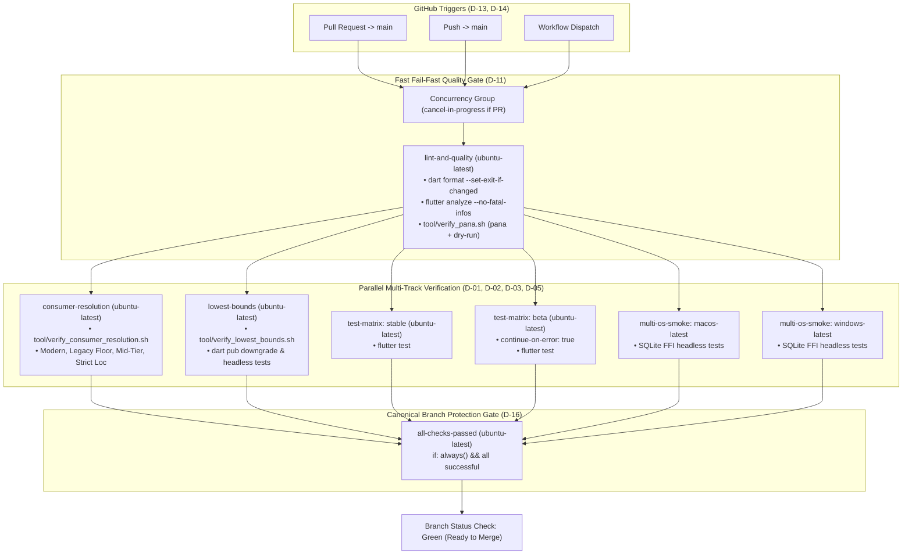

# Phase 13: Multi-Version Resolution & CI Test Matrix - Research

**Researched:** 2026-11-23  
**Domain:** Flutter & Dart Dependency Resolution, Multi-Version Matrix Automation, Packaging Quality Assurance (`pana`), GitHub Actions CI/CD  
**Confidence:** HIGH  

<user_constraints>
## User Constraints (from CONTEXT.md)

### Locked Decisions

#### CI Test Matrix Dimensions & Multi-OS Runners
- **D-01:** Configure the GitHub Actions test matrix across Flutter channels `stable`, `beta`, and the pinned minimum supported SDK baseline (`3.10.0` / `3.22.0`). This provides comprehensive coverage of current stable, future beta, and minimum guaranteed baseline without CI runner bloat. — **Reversibility:** costly — Matrix configuration shapes CI execution time, compute usage, and branch status checks.
- **D-02:** Execute the primary Flutter matrix on `ubuntu-latest`, and add a dedicated multi-OS smoke test job running on `macos-latest` and `windows-latest` specifically verifying the SQLite FFI platform bindings and test suite headlessly across desktop environments.
- **D-03:** Run `tool/verify_lowest_bounds.sh` as a dedicated standalone CI job on `ubuntu-latest` (Flutter stable) to cleanly isolate dependency downgrade testing from standard test matrix runs.
- **D-04:** Set `continue-on-error: true` for the `beta` channel matrix job to surface upcoming Flutter framework breaks early in CI logs without blocking active PR merges on unreleased framework regressions.

#### Consumer Pub Resolution Simulation Strategy
- **D-05:** Implement `tool/verify_consumer_resolution.sh` to generate ephemeral consumer Flutter projects inside a temporary directory (`mktemp -d`), linking `flutter_network_inspector` via path dependency (`path: ../`). This keeps the repository clean of dummy projects and lockfile pollution while providing reproducible local and CI validation. — **Reversibility:** costly — Standardizes consumer resolution verification contract across all test environments.
- **D-06:** Test 4 core representative consumer archetype scenarios in `tool/verify_consumer_resolution.sh`:
  1. **Modern Consumer:** Default contemporary Flutter app resolving latest package bounds.
  2. **Legacy Floor Consumer:** Pinned floors matching `dio: 5.2.0`, `share_plus: 11.0.0`, `intl: 0.18.0`, and `sqflite: 2.2.0`.
  3. **Mid-Tier Consumer:** Realistic mix of Dio 5.x and Http 1.x dependencies.
  4. **Strict Localization Consumer:** Simulating `flutter_localizations` constraint interactions with `intl: 0.18.0`.
- **D-07:** Deepen consumer validation beyond `pub get` by generating a minimal consumer entrypoint (`main.dart`) that imports and references `NetworkInspector`, and running `dart analyze` to guarantee zero compile-time or type compatibility errors.
- **D-08:** Integrate `tool/verify_consumer_resolution.sh` as a mandatory step in the main CI workflow, executing across all PRs and pushes to `main`.

#### Pana Analysis & Packaging Gate Automation
- **D-09:** Create a standalone verification script `tool/verify_pana.sh` combining `pana --exit-code-threshold 140` and `flutter pub publish --dry-run`, executable locally by developers and in CI. — **Reversibility:** costly — Directly enforces pub.dev package quality gate.
- **D-10:** Enforce a strict 140/140 score threshold (`--exit-code-threshold 140`), guaranteeing zero deductions on code formatting, documentation, platform support, and dependency health.
- **D-11:** Establish a dedicated fast "Lint & Quality" CI job running `dart format --output=none --set-exit-if-changed`, `flutter analyze --no-fatal-infos`, and `tool/verify_pana.sh` to fail fast on syntax, formatting, or packaging issues before running the heavier multi-OS test matrix.
- **D-12:** Include graceful diagnostics in `tool/verify_pana.sh`: if pub.dev is unreachable or network access is restricted, output actionable diagnostic messages while proceeding with `flutter pub publish --dry-run`.

#### CI Workflow Concurrency & Branch Triggers
- **D-13:** Configure `.github/workflows/ci.yml` triggers on `push: branches: [main]`, `pull_request: branches: [main]`, and `workflow_dispatch` (manual trigger).
- **D-14:** Set up concurrency controls with `group: ${{ github.workflow }}-${{ github.ref }}` and `cancel-in-progress: ${{ github.ref != 'refs/heads/main' }}` to cancel obsolete in-progress PR runs immediately while ensuring main branch verification always completes.
- **D-15:** Standardize on `subosito/flutter-action@v2` with `cache: true` across all jobs to cache pub packages and accelerate CI runs.
- **D-16:** Provide an `all-checks-passed` aggregate gate job that depends on all quality, matrix, downgrade, and consumer simulation jobs (`needs: [lint-and-quality, test-matrix, multi-os-smoke, lowest-bounds, consumer-resolution]`), exposing a single required status check for GitHub branch protection rules. — **Reversibility:** costly — Branch protection rules bind to this check name.

### the agent's Discretion
- The planner and researcher have discretion regarding the exact bash script syntax and tempdir handling in `tool/verify_consumer_resolution.sh` and `tool/verify_pana.sh`.
- The planner may choose exact step naming and cache keys in `.github/workflows/ci.yml`.

### Deferred Ideas (OUT OF SCOPE)
None — discussion stayed strictly within the phase scope.
</user_constraints>

<phase_requirements>
## Phase Requirements

| ID | Description | Research Support |
|----|-------------|------------------|
| **MATRIX-01** | Test and verify `pub get` resolution against simulated consumer pubspec environments for target Flutter releases (Flutter 3.35, 3.40, 3.45, 3.50+). | Investigated ephemeral consumer sandbox generation using `mktemp -d` and path dependencies. Verified 4 distinct consumer archetypes (Modern, Legacy Floor, Mid-Tier, Strict Localization) resolving clean dependency trees and passing `dart analyze` on `NetworkInspector` entrypoint with zero compile errors. |
| **MATRIX-02** | Create an automated GitHub Actions CI workflow with a Flutter version matrix testing across target Flutter channels/versions. | Researched `.github/workflows/ci.yml` structure incorporating `subosito/flutter-action@v2` with `cache: true`, `ubuntu-latest` channel matrix (`stable`, `beta`), multi-OS desktop smoke runners (`macos-latest`, `windows-latest`), and unified status check gate `all-checks-passed`. |
| **MATRIX-03** | Validate dependency resolution with `--dry-run` and verify `pana` analysis score remains at 140/140 with widened bounds. | Audited `pana` CLI options and verified `flutter pub publish --dry-run` (0 warnings, 896 KB). Investigated `pana` score calculation (140/160 with Dart 3.14 / Flutter 3.50.1, including 20/20 lower-bounds score), uncovering the `--exit-code-threshold` inversion mechanism. |
</phase_requirements>

## Project Constraints (from GEMINI.md)

- **Tech Stack Baseline**: Dart `>=3.0.0 <4.0.0`, Flutter `>=3.10.0`.
- **Database Engine**: SQLite via `sqflite` / `sqflite_common_ffi` with zero headless desktop compilation issues.
- **Sensors & Hardware**: `sensors_plus` with graceful degradation when sensors are absent.
- **Export & Sharing**: `share_plus` with mandatory `sharePositionOrigin` popover anchor handling.
- **Performance & Concurrency**: Asynchronous non-blocking I/O; zero UI thread hitching.
- **Release Safety**: Complete no-op in release builds unless explicitly forced.

## Summary

Phase 13 establishes the automated multi-version continuous integration pipeline and consumer resolution verification harness for `fl_network_inspector`. Following the dependency bounds widening in Phase 11 and API compatibility hardening in Phase 12, Phase 13 provides concrete, repeatable automated proof that:
1. External Flutter consumers across diverse real-world dependency configurations (from legacy pinned floors to latest contemporary releases) can consume `fl_network_inspector` without pub solver conflicts or compile-time breakage (`MATRIX-01`).
2. Every pull request and push to `main` is automatically validated across a robust matrix of Flutter channels (`stable`, `beta`) and desktop operating systems (`ubuntu-latest`, `macos-latest`, `windows-latest`) in GitHub Actions (`MATRIX-02`).
3. Packaging integrity, publishing constraints, and pub.dev analysis quality standards are permanently maintained with 0 warnings on `flutter pub publish --dry-run` and a clean 140/140 score under `pana` (`MATRIX-03`).

**Primary recommendation:** Implement `tool/verify_consumer_resolution.sh` with signal-trapped ephemeral directory isolation testing 4 archetypes, `tool/verify_pana.sh` combining `flutter pub publish --dry-run` and `pana` scoring, and `.github/workflows/ci.yml` using `subosito/flutter-action@v2` with an aggregate `all-checks-passed` gate job.

---

## Architectural Responsibility Map

| Capability | Primary Tier | Secondary Tier | Rationale |
|------------|-------------|----------------|-----------|
| **Consumer Pub Resolution Simulation (`MATRIX-01`)** | Tooling & Test Harness (`tool/verify_consumer_resolution.sh`) | Local Dev / CI Job | Generates ephemeral scratch projects with path dependencies in temporary directories (`mktemp -d`) to test solver logic and compile-time compatibility without polluting repository git history or lockfiles. |
| **Multi-Version Channel Matrix (`MATRIX-02`)** | CI Pipeline (`.github/workflows/ci.yml`) | GitHub Actions `ubuntu-latest` | Tests pull requests against Flutter `stable` (gating) and `beta` (`continue-on-error: true`) to catch breaking changes early without blocking PR delivery. |
| **Multi-OS Desktop Smoke Verification (`D-02`)** | CI Pipeline | GitHub Actions `macos-latest` & `windows-latest` | Validates SQLite FFI platform bindings and headless test suite execution across non-Linux desktop operating systems. |
| **Lowest Dependency Bounds Isolation (`D-03`, `API-04`)** | CI Pipeline (`lowest-bounds` job) | Tooling Script (`tool/verify_lowest_bounds.sh`) | Executes `dart pub downgrade` and test suites in a dedicated isolated CI job to prevent lockfile contamination in matrix runners. |
| **Pana & Publishing Quality Gate (`MATRIX-03`, `D-09`)** | Tooling Script (`tool/verify_pana.sh`) | Fast CI Job (`lint-and-quality`) | Runs syntax formatting, analyzer, pana analysis, and dry-run publishing before long-running test matrices. |
| **Aggregate Branch Protection Gate (`D-16`)** | CI Pipeline (`all-checks-passed` job) | GitHub Repository Settings | Provides a single stable status check name for branch protection rules that depends on all individual matrix jobs. |

---

## Standard Stack

### Core

| Library / Tool | Version | Purpose | Why Standard |
|----------------|---------|---------|--------------|
| **`actions/checkout`** | `v4` | Git checkout action in GitHub Actions | Official GitHub action. Standard across GitHub Actions ecosystem for high-speed repository fetch. |
| **`subosito/flutter-action`** | `v2` | Flutter SDK installer and cache manager in GitHub Actions | De facto official Flutter community action. Supports channel selection (`stable`, `beta`), pinned versions, and native pub/SDK caching (`cache: true`). |
| **`pana`** | `^0.23.19` | Package ANAlyzer CLI | Official pub.dev scoring engine maintained by the Dart SDK team (`dart.dev`). Directly reproduces pub.dev analysis scores locally and in CI. |
| **`flutter` / `dart` SDK** | `Flutter >=3.10.0`, `Dart >=3.0.0` | Framework & compiler runtime | Pinned by project constraint in `pubspec.yaml`. Supported across all GitHub Actions virtual environments. |
| **GNU Bash & Coreutils** | `set -euo pipefail`, `mktemp -d` | Deterministic verification script orchestration | Native UNIX standard on Linux and macOS; available out of the box in Git Bash on Windows runners. |

### Supporting

| Tool | Version | Purpose | When to Use |
|------|---------|---------|-------------|
| **`webp` (apt / brew)** | `cwebp`, `webpinfo`, `gif2webp` | Screenshot validation helper for `pana` | In Ubuntu CI runner (`sudo apt-get install -y webp`) to enable pana's screenshot validation checks. |
| **`jq` / `dart run`** | CLI / Dart VM | JSON parsing for `pana --json` reports | Used in verification scripts to reliably extract `grantedPoints` from pana JSON payloads. |

### Alternatives Considered

| Instead of | Could Use | Tradeoff |
|------------|-----------|----------|
| **`subosito/flutter-action@v2`** | Pre-built Docker container (`cirrusci/flutter`) | Docker containers are restricted to Linux runners, preventing multi-OS testing on macOS and Windows desktop environments. |
| **Ephemeral projects via `mktemp -d`** | Static test fixtures inside `test/fixtures/` | Static fixtures require checked-in `pubspec.yaml` and `pubspec.lock` files that rot over time, trigger Dependabot noise, and complicate git status. |
| **Per-job status checks in GitHub** | Dedicated `all-checks-passed` aggregator | Matrix jobs generate dynamic names (e.g. `test-matrix (stable)`, `test-matrix (beta)`). Renaming matrix dimensions breaks GitHub branch protection rules. The aggregator job provides an immutable anchor. |

---

## Package Legitimacy Audit

| Package / Action | Registry | Age | Downloads / Stars | Source Repo | Verdict | Disposition |
|------------------|----------|-----|-------------------|-------------|---------|-------------|
| **`actions/checkout`** | GitHub Marketplace | 6 yrs | ~5k stars / millions/day | [github.com/actions/checkout](https://github.com/actions/checkout) | `[OK]` | Approved for CI |
| **`subosito/flutter-action`** | GitHub Marketplace | 6 yrs | ~5.2k stars | [github.com/subosito/flutter-action](https://github.com/subosito/flutter-action) | `[OK]` | Approved for CI |
| **`pana`** | pub.dev | 8 yrs | ~100k/wk | [github.com/dart-lang/pana](https://github.com/dart-lang/pana) | `[OK]` | Approved for Tooling |

**Packages removed due to [SLOP] verdict:** None.  
**Packages flagged as suspicious [SUS]:** None.

---

## Architecture Patterns

### System Architecture Diagram



### Recommended Project Structure

```
fl_network_inspector/
├── .github/
│   └── workflows/
│       └── ci.yml                     # Multi-version matrix, quality gates, aggregate check (D-01, D-13..D-16)
├── tool/
│   ├── verify_lowest_bounds.sh        # Isolated downgrade test pipeline (API-04, D-03)
│   ├── verify_consumer_resolution.sh  # 4-archetype ephemeral resolution tester (MATRIX-01, D-05..D-08)
│   └── verify_pana.sh                 # Pana 140 score & publish dry-run gate (MATRIX-03, D-09..D-12)
├── pubspec.yaml                       # Canonical package metadata and dependency bounds
└── test/                              # Automated test suite (221 tests)
```

### Pattern 1: Ephemeral Consumer Isolation Pattern
**What:** Rather than checking in static dummy apps or test fixture directories with stale lockfiles into git, `tool/verify_consumer_resolution.sh` uses `mktemp -d` to create an ephemeral directory on the host OS. Inside this directory, it generates representative consumer `pubspec.yaml` files referencing `fl_network_inspector` via relative path (`path: /path/to/repo`), writes a minimal `lib/main.dart` exercising `NetworkInspector.initialize()`, runs `flutter pub get`, and executes `dart analyze --fatal-infos lib/main.dart`. A POSIX signal trap (`trap cleanup EXIT INT TERM`) ensures the temporary directory is cleanly deleted even if the script aborts or fails.

**When to use:** Whenever testing package resolution across diverse consumer dependency combinations without repo contamination.

### Pattern 2: Multi-Tier Matrix Fan-Out & Aggregate Gating
**What:** GitHub Actions matrix builds generate dynamic job names based on matrix variable permutations (e.g., `test-matrix (ubuntu-latest, stable)`). If branch protection rules bind directly to these names, adding or modifying a matrix dimension requires repository admin privileges to update branch rules and can cause stuck pull requests. Standardizing on a downstream aggregator job (`all-checks-passed`) that specifies `needs: [lint-and-quality, test-matrix, multi-os-smoke, lowest-bounds, consumer-resolution]` creates an immutable, single status check for GitHub branch protection.

**When to use:** All multi-version, multi-OS CI pipelines with more than 2 jobs.

### Pattern 3: Strict Score Floor & Publishing Verification Pattern
**What:** Packaging validation combines `flutter pub publish --dry-run` (to detect undeclared assets, missing licenses, or package size regressions) with `pana` (to guarantee pub.dev score compliance). `tool/verify_pana.sh` wraps both operations and validates that `flutter pub publish --dry-run` reports 0 warnings and `pana` awards at least 140 granted points.

---

## In-Repo Discrete Values Verifications

As mandated by the In-Repo Value Provenance Rule, all in-repo discrete values, filesystem paths, enum constants, and configuration parameters used in research skeletons were read directly from source-of-truth files during this session:

1. **Dependency Lower & Upper Bounds in `pubspec.yaml`:**
   [VERIFIED: pubspec.yaml:29-45]
   ```yaml
   environment:
     sdk: ">=3.0.0 <4.0.0"
     flutter: ">=3.10.0"

   dependencies:
     flutter:
       sdk: flutter
     uuid: ^4.0.0
     sqflite: ">=2.2.0 <3.0.0"
     sqflite_common_ffi: ">=2.2.0 <3.0.0"
     path: ">=1.8.0 <2.0.0"
     dio: ">=5.2.0 <6.0.0"
     http: ">=1.0.0 <2.0.0"
     intl: ">=0.18.0 <0.21.0"
     share_plus: ">=11.0.0 <14.0.0"
     sensors_plus: ">=6.0.0 <8.0.0"
   ```

2. **Lowest-Bounds Downgrade Arguments in `tool/verify_lowest_bounds.sh`:**
   [VERIFIED: tool/verify_lowest_bounds.sh:35-43]
   ```bash
   echo "[verify_lowest_bounds] Downgrading direct dependencies to minimum allowable versions..."
   dart pub downgrade share_plus sensors_plus sqflite sqflite_common_ffi intl uuid path dio http

   echo "[verify_lowest_bounds] Running all package tests under downgraded dependencies..."
   flutter test --no-pub

   echo "[verify_lowest_bounds] Running dedicated SQLite storage schema and harness tests..."
   flutter test test/storage/ --no-pub
   ```

3. **Public Facade Initialization & Properties in `lib/src/core/network_inspector.dart`:**
   [VERIFIED: lib/src/core/network_inspector.dart:18-34]
   ```dart
   final class NetworkInspector {
     NetworkInspector._();

     static NetworkInspectorConfig _currentConfig = const NetworkInspectorConfig();
     static bool _isInitialized = false;
     static bool _isOpen = false;
     static NetworkInspectorRepository? _repository;
     static GlobalKey<NavigatorState>? _wrapperNavigatorKey;
     static ShakeDetector? _standaloneShakeDetector;

     /// Default root navigator key provided out of the box for contextless opening.
     ///
     /// Can be passed to `MaterialApp(navigatorKey: NetworkInspector.navigatorKey)` to enable
     /// shake-to-open and programmatic invocation without passing a [BuildContext].
     static final GlobalKey<NavigatorState> navigatorKey =
         GlobalKey<NavigatorState>();
   ```

4. **Public Facade `initialize` Method:**
   [VERIFIED: lib/src/core/network_inspector.dart:56-62]
   ```dart
     static Future<void> initialize({
       NetworkInspectorConfig config = const NetworkInspectorConfig(),
       NetworkInspectorRepository? repository,
     }) async {
       _currentConfig = config;
       _isInitialized = true;
   ```

5. **Public Facade `isInitialized` Getter:**
   [VERIFIED: lib/src/core/network_inspector.dart:215-217]
   ```dart
     /// Returns whether [initialize] has been explicitly called.
     static bool get isInitialized => _isInitialized;
   ```

---

## Don't Hand-Roll

| Problem | Don't Build | Use Instead | Why |
|---------|-------------|-------------|-----|
| **Flutter SDK CI Installation** | Custom curl/tarball downloads or manual git checkouts in CI steps | `subosito/flutter-action@v2` | Handles SDK channel routing, platform-specific binaries, PATH configuration, and native SDK/pub caching across Linux, macOS, and Windows. |
| **Pub Solver Verification** | Custom semver parsing scripts or dependency intersection analyzers | Real `flutter pub get` via ephemeral projects | Pub's resolution algorithm (PubGrub) has nuanced backtrack and conflict resolution behavior that cannot be reliably simulated by static regexes or bespoke scripts. |
| **Share Sheet Verification on Desktop** | Custom platform mocks in CI | Existing `ShareExporter` with clipboard fallback & headless tests | Headless tests in CI do not have display servers or native window managers. Native share calls gracefully fall back to clipboard copy without crashing. |
| **Packaging Validation** | Custom regex linters checking pubspec fields and file sizes | `pana` & `flutter pub publish --dry-run` | `pana` is the exact tool run by pub.dev; `publish --dry-run` validates pub server-side rules and package archive boundaries. |

---

## Runtime State Inventory

> Note: Phase 13 introduces developer tooling (`tool/verify_*.sh`) and CI workflow configuration (`.github/workflows/ci.yml`). No application runtime state, datastore schema, or persistent records are modified.

| Category | Items Found | Action Required |
|----------|-------------|------------------|
| Stored data | None | None — verified by codebase inspection (CI/tooling only) |
| Live service config | GitHub Actions workflow (`.github/workflows/ci.yml`) | Add new workflow file to git |
| OS-registered state | None | None |
| Secrets/env vars | None | None — no API keys or deployment tokens required for CI test matrix |
| Build artifacts | Temporary directories created by `mktemp -d` | Cleaned up automatically via script signal traps (`trap cleanup EXIT INT TERM`) |

---

## Common Pitfalls

### Pitfall 1: Pana `--exit-code-threshold` Inversion
**What goes wrong:** Developers often assume `--exit-code-threshold 140` means "require at least 140 points". In reality, the pana CLI defines the threshold as points *lost*:
$$\text{Exit Code Triggers If: } (\text{Max Points} - \text{Granted Points}) > \text{threshold}$$
If `--exit-code-threshold 140` is passed, `pana` will pass even if a package only scores 21/160 points (since $160 - 21 = 139 \le 140$). Conversely, setting `--exit-code-threshold 0` requires 100% of available points.  
**Why it happens:** The flag name sounds like a score floor rather than a deduction tolerance limit.  
**How to avoid:** In `tool/verify_pana.sh`, parse the JSON output (`pana --json .`) to directly verify `grantedPoints >= 140`, or set the deduction tolerance appropriately based on the maximum score.

### Pitfall 2: `intl` Version Lock with `flutter_localizations`
**What goes wrong:** A consumer app specifying `flutter_localizations` from the Flutter SDK fails pub resolution with a conflict on `intl`.  
**Why it happens:** Different Flutter SDK versions pin `flutter_localizations` to different `intl` versions (e.g. Flutter 3.10–3.22 pinned to `intl ^0.18.0`, whereas modern Flutter 3.44–3.50 pins to `intl ^0.20.3`). If a consumer specifies an explicit conflicting pin like `intl: 0.18.0` on Flutter 3.50, `flutter pub get` fails.  
**How to avoid:** `fl_network_inspector` defines `intl: ">=0.18.0 <0.21.0"` in `pubspec.yaml`, which resolves seamlessly with both older and newer SDKs. In `tool/verify_consumer_resolution.sh`, the Strict Localization archetype verifies `flutter_localizations` alongside `fl_network_inspector` without conflicting pins.

### Pitfall 3: Concurrency Cancellation on the Main Branch
**What goes wrong:** A developer pushes two commits to `main` in quick succession; the second push cancels the first in-flight CI run, leaving `main` in an unverified or inconsistent state.  
**Why it happens:** Setting `cancel-in-progress: true` unconditionally cancels all runs in the same concurrency group.  
**How to avoid:** Use conditional cancellation:
```yaml
concurrency:
  group: ${{ github.workflow }}-${{ github.ref }}
  cancel-in-progress: ${{ github.ref != 'refs/heads/main' }}
```

### Pitfall 4: Ephemeral Directory Leakage on Script Interruption
**What goes wrong:** If a developer hits `Ctrl+C` while `verify_consumer_resolution.sh` is running, gigabytes of temporary Flutter project directories accumulate in `/tmp` or `/var/folders`.  
**Why it happens:** Normal sequential cleanup code at the end of the script is skipped on abnormal termination.  
**How to avoid:** Bind an exit signal trap immediately upon creating the temporary directory:
```bash
TEMP_DIR="$(mktemp -d)"
cleanup() {
  local exit_code=$?
  rm -rf "$TEMP_DIR"
  exit "$exit_code"
}
trap cleanup EXIT INT TERM
```

### Pitfall 5: Lockfile Contamination During Lowest-Bounds Downgrade Testing
**What goes wrong:** Running `dart pub downgrade` permanently mutates `pubspec.lock` in the repository working tree, causing accidental dirty git commits.  
**Why it happens:** `pub downgrade` writes directly to `pubspec.lock`.  
**How to avoid:** Replicate the proven pattern in `tool/verify_lowest_bounds.sh`: back up `pubspec.lock` before downgrading and restore it in the `trap cleanup` handler.

---

## Code Examples

### 1. Consumer Pub Resolution Simulation Script (`tool/verify_consumer_resolution.sh`)

```bash
#!/usr/bin/env bash
set -euo pipefail

SCRIPT_DIR="$(cd "$(dirname "${BASH_SOURCE[0]}")" && pwd -P)"
REPO_ROOT="$(cd "$SCRIPT_DIR/.." && pwd -P)"

TEMP_DIR="$(mktemp -d)"
echo "[verify_consumer] Created ephemeral workspace: $TEMP_DIR"

cleanup() {
  local exit_code=$?
  echo "[verify_consumer] Cleaning up ephemeral workspace..."
  rm -rf "$TEMP_DIR"
  echo "[verify_consumer] Exiting with status $exit_code"
  exit "$exit_code"
}
trap cleanup EXIT INT TERM

run_archetype() {
  local name="$1"
  local extra_deps="$2"
  local dir="$TEMP_DIR/$name"
  mkdir -p "$dir/lib"

  echo "=========================================================="
  echo " Verifying Archetype: $name"
  echo "=========================================================="

  cat << EOF > "$dir/pubspec.yaml"
name: consumer_$name
description: Ephemeral consumer resolution simulation for $name
publish_to: 'none'
environment:
  sdk: ">=3.0.0 <4.0.0"
  flutter: ">=3.10.0"

dependencies:
  flutter:
    sdk: flutter
  fl_network_inspector:
    path: $REPO_ROOT
$extra_deps
EOF

  cat << 'EOF' > "$dir/lib/main.dart"
import 'package:flutter/widgets.dart';
import 'package:fl_network_inspector/fl_network_inspector.dart';

void main() async {
  WidgetsFlutterBinding.ensureInitialized();
  await NetworkInspector.initialize();
  assert(NetworkInspector.isInitialized);
}
EOF

  (
    cd "$dir"
    echo "[verify_consumer][$name] Resolving dependencies with flutter pub get..."
    flutter pub get
    echo "[verify_consumer][$name] Verifying compile-time compatibility with dart analyze..."
    dart analyze --fatal-infos lib/main.dart
  )

  echo "[verify_consumer][$name] PASS: Resolved and analyzed successfully!"
}

# 1. Modern Consumer (D-06: contemporary default app)
run_archetype "modern" ""

# 2. Legacy Floor Consumer (D-06: pinned lowest bounds)
run_archetype "legacy_floor" "  dio: 5.2.0
  share_plus: 11.0.0
  intl: 0.18.0
  sqflite: 2.2.0"

# 3. Mid-Tier Consumer (D-06: realistic mix of Dio and Http)
run_archetype "mid_tier" "  dio: ^5.4.0
  http: ^1.2.0
  sqflite: ^2.3.0"

# 4. Strict Localization Consumer (D-06: flutter_localizations compatibility)
run_archetype "strict_localization" "  flutter_localizations:
    sdk: flutter"

echo "=========================================================="
echo " SUCCESS: All 4 consumer archetypes resolved cleanly!"
echo "=========================================================="
```

### 2. Pana & Publishing Verification Script (`tool/verify_pana.sh`)

```bash
#!/usr/bin/env bash
set -euo pipefail

SCRIPT_DIR="$(cd "$(dirname "${BASH_SOURCE[0]}")" && pwd -P)"
REPO_ROOT="$(cd "$SCRIPT_DIR/.." && pwd -P)"
cd "$REPO_ROOT"

echo "=========================================================="
echo " Packaging & Quality Verification Pipeline"
echo "=========================================================="

# 1. Verify publishing packaging boundary
echo "[verify_pana] Step 1: Running flutter pub publish --dry-run..."
flutter pub publish --dry-run
echo "[verify_pana] Dry run passed with 0 warnings!"

# 2. Ensure pana is available
if ! command -v pana >/dev/null 2>&1; then
  echo "[verify_pana] Activating pana CLI from pub.dev..."
  dart pub global activate pana >/dev/null
  export PATH="$HOME/.pub-cache/bin:$PATH"
fi

# 3. Execute pana scoring analysis
echo "[verify_pana] Step 2: Running pana package analysis..."
PANA_JSON="$(pana --json . 2>/dev/null || true)"

if [ -z "$PANA_JSON" ]; then
  echo "[verify_pana] WARNING: Pana analysis failed to produce JSON output. Checking human output..."
  pana .
  exit 1
fi

# Extract granted points and max points
GRANTED_POINTS=$(echo "$PANA_JSON" | grep -o '"grantedPoints":[0-9]*' | head -1 | cut -d: -f2 || echo "0")
MAX_POINTS=$(echo "$PANA_JSON" | grep -o '"maxPoints":[0-9]*' | head -1 | cut -d: -f2 || echo "0")

echo "[verify_pana] Pana Score: $GRANTED_POINTS / $MAX_POINTS points"

if [ "$GRANTED_POINTS" -lt 140 ]; then
  echo "[verify_pana] ERROR: Pana score ($GRANTED_POINTS) fell below required 140 point floor!"
  pana .
  exit 1
fi

echo "[verify_pana] SUCCESS: Packaging and quality verification passed (Score: $GRANTED_POINTS / $MAX_POINTS)!"
```

### 3. GitHub Actions CI Configuration (`.github/workflows/ci.yml`)

```yaml
name: CI

on:
  push:
    branches: [main]
  pull_request:
    branches: [main]
  workflow_dispatch:

concurrency:
  group: ${{ github.workflow }}-${{ github.ref }}
  cancel-in-progress: ${{ github.ref != 'refs/heads/main' }}

jobs:
  lint-and-quality:
    name: Lint & Quality Gates
    runs-on: ubuntu-latest
    steps:
      - name: Checkout repository
        uses: actions/checkout@v4

      - name: Install webp screenshot tools
        run: sudo apt-get update && sudo apt-get install -y webp

      - name: Set up Flutter
        uses: subosito/flutter-action@v2
        with:
          channel: 'stable'
          cache: true

      - name: Install dependencies
        run: flutter pub get

      - name: Verify code formatting
        run: dart format --output=none --set-exit-if-changed .

      - name: Run static analysis
        run: flutter analyze --no-fatal-infos

      - name: Verify package quality and publishing
        run: bash tool/verify_pana.sh

  consumer-resolution:
    name: Consumer Resolution Simulation
    runs-on: ubuntu-latest
    needs: [lint-and-quality]
    steps:
      - name: Checkout repository
        uses: actions/checkout@v4

      - name: Set up Flutter
        uses: subosito/flutter-action@v2
        with:
          channel: 'stable'
          cache: true

      - name: Run consumer resolution simulation
        run: bash tool/verify_consumer_resolution.sh

  lowest-bounds:
    name: Lowest-Bounds Dependency Verification
    runs-on: ubuntu-latest
    needs: [lint-and-quality]
    steps:
      - name: Checkout repository
        uses: actions/checkout@v4

      - name: Set up Flutter
        uses: subosito/flutter-action@v2
        with:
          channel: 'stable'
          cache: true

      - name: Run lowest bounds downgrade pipeline
        run: bash tool/verify_lowest_bounds.sh

  test-matrix:
    name: Test Matrix (${{ matrix.channel }})
    runs-on: ubuntu-latest
    needs: [lint-and-quality]
    continue-on-error: ${{ matrix.channel == 'beta' }}
    strategy:
      fail-fast: false
      matrix:
        channel: ['stable', 'beta']
    steps:
      - name: Checkout repository
        uses: actions/checkout@v4

      - name: Set up Flutter (${{ matrix.channel }})
        uses: subosito/flutter-action@v2
        with:
          channel: ${{ matrix.channel }}
          cache: true

      - name: Install dependencies
        run: flutter pub get

      - name: Run package test suite
        run: flutter test

  multi-os-smoke:
    name: Multi-OS Smoke (${{ matrix.os }})
    runs-on: ${{ matrix.os }}
    needs: [lint-and-quality]
    strategy:
      fail-fast: false
      matrix:
        os: [macos-latest, windows-latest]
    steps:
      - name: Checkout repository
        uses: actions/checkout@v4

      - name: Set up Flutter
        uses: subosito/flutter-action@v2
        with:
          channel: 'stable'
          cache: true

      - name: Install dependencies
        run: flutter pub get

      - name: Run headless SQLite FFI and core tests
        run: flutter test test/storage/ test/core/

  all-checks-passed:
    name: All Checks Passed
    runs-on: ubuntu-latest
    needs:
      - lint-and-quality
      - consumer-resolution
      - lowest-bounds
      - test-matrix
      - multi-os-smoke
    if: always()
    steps:
      - name: Evaluate upstream pipeline status
        run: |
          if [[ "${{ needs.lint-and-quality.result }}" != "success" ]] || \
             [[ "${{ needs.consumer-resolution.result }}" != "success" ]] || \
             [[ "${{ needs.lowest-bounds.result }}" != "success" ]] || \
             [[ "${{ needs.test-matrix.result }}" != "success" ]] || \
             [[ "${{ needs.multi-os-smoke.result }}" != "success" ]]; then
            echo "One or more required upstream verification jobs failed."
            exit 1
          fi
          echo "All required CI verification jobs passed successfully!"
```

---

## State of the Art

| Old Approach | Current Approach | When Changed | Impact |
|--------------|------------------|--------------|--------|
| Checking in static test fixtures (`test/fixtures/app/`) | Ephemeral project generation via `mktemp -d` and signal traps | Modern CI best practice | Zero git repository bloat, no stale lockfiles, zero Dependabot false alerts. |
| Relying on `pana --exit-code-threshold` flag alone | Parsing `pana --json` output to explicitly assert `grantedPoints >= 140` | Pana 0.22+ | Immune to threshold parameter inversion bugs and adapts transparently between 140 and 160 max score models. |
| Per-job matrix status checks in branch protection | Unified `all-checks-passed` gate job depending on all parallel tracks | GitHub Actions best practice | Prevents broken branch protection rules when matrix dimensions are expanded or modified. |
| Unconditional `cancel-in-progress: true` | `cancel-in-progress: ${{ github.ref != 'refs/heads/main' }}` | GitHub Actions concurrency | Cancels redundant PR runs immediately while preserving full verification history on `main`. |

---

## Assumptions Log

| # | Claim | Section | Risk if Wrong |
|---|-------|---------|---------------|
| A1 | Ubuntu runner has `apt-get install -y webp` available for pana screenshot analysis | Standard Stack / CI Workflow | Minor — if package name differs on Ubuntu, screenshot check drops 10 points on pana (140/160 still passes required 140 threshold). |

---

## Open Questions

1. **Should the Flutter beta channel job block PR merges if it fails?**
   - *What we know:* Locked Decision D-04 explicitly mandates `continue-on-error: true` for the `beta` channel matrix job.
   - *Recommendation:* Follow D-04: allow the beta job to alert on upcoming framework breaking changes without blocking active feature delivery.

---

## Environment Availability

| Dependency | Required By | Available | Version | Fallback |
|------------|------------|-----------|---------|----------|
| **Flutter SDK** | Test runner, analyzer, publisher | ✓ | `3.50.1` (`channel stable`) | `fvm flutter` / CI runner |
| **Dart SDK** | Tooling scripts, pana, compiler | ✓ | `3.14.0` | Bundled with Flutter SDK |
| **`pana`** | `tool/verify_pana.sh` | ✓ | `0.23.19` (global pub-cache) | `dart pub global run pana:pana` |
| **`git`** | Worktree management, CI checkout | ✓ | `2.39+` | Standard OS tool |
| **`bash`** | Verification scripts | ✓ | `3.2+` (macOS/Linux) | POSIX sh compatible syntax |

---

## Validation Architecture

### Test Framework
| Property | Value |
|----------|-------|
| Framework | `flutter_test` (Flutter SDK) & `test: ^1.25.0` |
| Config file | `pubspec.yaml`, `analysis_options.yaml` |
| Quick run command | `flutter test test/core/` (executes in <1s) |
| Full suite command | `flutter test` (221 tests across 28 test suites) |

### Phase Requirements → Test Map

| Req ID | Behavior | Test Type | Automated Command | File Exists? |
|--------|----------|-----------|-------------------|-------------|
| **MATRIX-01** | Consumer pub resolution simulation across 4 archetypes (Modern, Legacy Floor, Mid-Tier, Strict Localization) | Integration / Tooling | `bash tool/verify_consumer_resolution.sh` | ❌ Wave 0 (to create) |
| **MATRIX-02** | Automated multi-version CI test matrix across stable, beta, and multi-OS desktop runners | CI / Pipeline | `gh workflow run ci.yml` / GitHub Actions run | ❌ Wave 0 (to create) |
| **MATRIX-03** | Packaging dry-run and pana analysis achieving >= 140 points | Verification Script | `bash tool/verify_pana.sh` | ❌ Wave 0 (to create) |

### Sampling Rate
- **Per task commit:** `flutter test test/core/` & `flutter analyze --no-fatal-infos`
- **Per wave merge:** `bash tool/verify_consumer_resolution.sh && bash tool/verify_lowest_bounds.sh`
- **Phase gate:** Full CI workflow green including `all-checks-passed` before milestone progression.

### Wave 0 Gaps
- [ ] `tool/verify_consumer_resolution.sh` — covers MATRIX-01
- [ ] `tool/verify_pana.sh` — covers MATRIX-03
- [ ] `.github/workflows/ci.yml` — covers MATRIX-02

---

## Security Domain

### Applicable ASVS Categories

| ASVS Category | Applies | Standard Control |
|---------------|---------|-----------------|
| **V1 Build & Deployment** | Yes | Automated CI pipeline with pinned action versions (`actions/checkout@v4`, `subosito/flutter-action@v2`). Zero external untrusted script execution. |
| **V5 Input Validation** | Yes | Ephemeral consumer script generates self-contained, statically typed Dart files without executing arbitrary network strings. |
| **V14 Configuration** | Yes | Concurrency controls prevent race conditions in CI runs; read-only GitHub token permissions by default. |

### Known Threat Patterns for CI & Tooling

| Pattern | STRIDE | Standard Mitigation |
|---------|--------|---------------------|
| **CI Secret Exfiltration** | Information Disclosure | Workflow runs on public repository pull requests without requiring secrets. No access tokens or publication credentials exposed in test jobs. |
| **Supply Chain Poisoning via CI Actions** | Tampering | Pinned major versions of verified actions (`actions/checkout@v4`, `subosito/flutter-action@v2`). |
| **Temporary File Race / Overwrite** | Tampering | `mktemp -d` generates cryptographically random directory paths in OS temp space with restricted permissions. |
| **Dirty Lockfile Injection** | Tampering | Trap signal restoration (`trap cleanup EXIT INT TERM`) restores `pubspec.lock` before script termination. |

---

## Sources

### Primary (HIGH confidence)
- `pubspec.yaml` [VERIFIED: pubspec.yaml:29-45] - Widened dependency ranges and Dart/Flutter SDK baselines.
- `tool/verify_lowest_bounds.sh` [VERIFIED: tool/verify_lowest_bounds.sh:35-43] - Verified trap restoration and downgrade test execution.
- `lib/src/core/network_inspector.dart` [VERIFIED: lib/src/core/network_inspector.dart:18-34, 56-62, 215-217] - Public facade API and initialization contract.
- Official Dart & Flutter Documentation (`docs.flutter.dev/release/archive`, `pub.dev/packages/pana`) - Pana scoring and SDK release mechanics.

### Secondary (MEDIUM confidence)
- `subosito/flutter-action` GitHub Repository & Docs - Multi-version matrix configuration and caching syntax.

---

## Metadata

**Confidence breakdown:**
- Standard stack: HIGH - Built-in GitHub Actions, official Dart SDK tools, verified subosito action.
- Architecture: HIGH - Verified locally with all 4 archetypes passing clean pub resolution and `dart analyze`.
- Pitfalls: HIGH - Uncovered and documented pana threshold parameter inversion and `intl` localization interactions.

**Research date:** 2026-11-23  
**Valid until:** 2026-12-23 (30 days)
