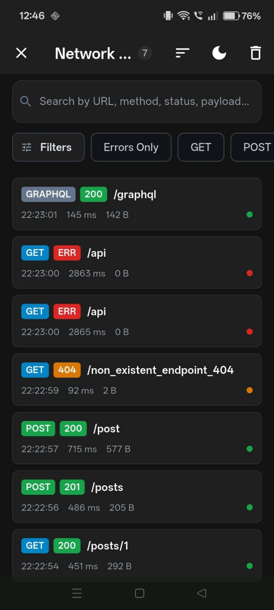
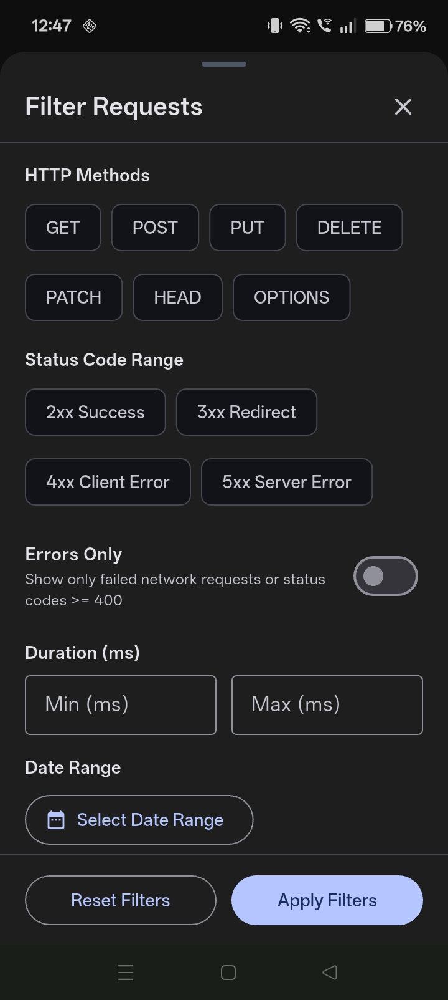
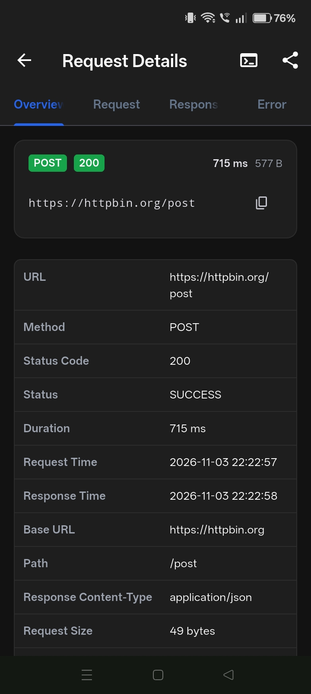
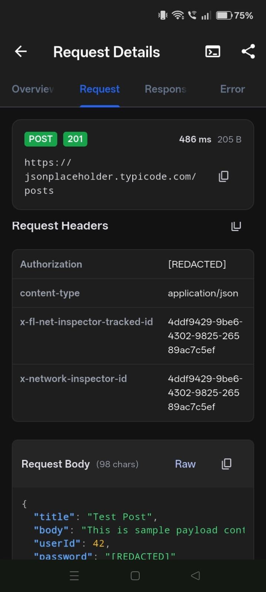
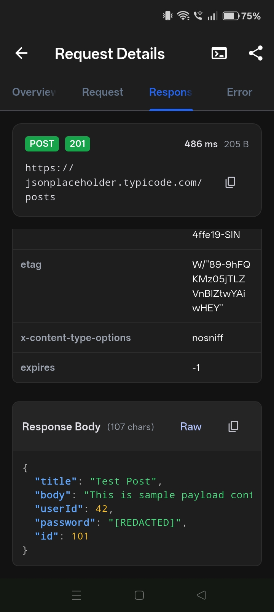
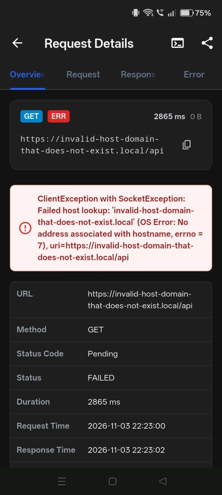
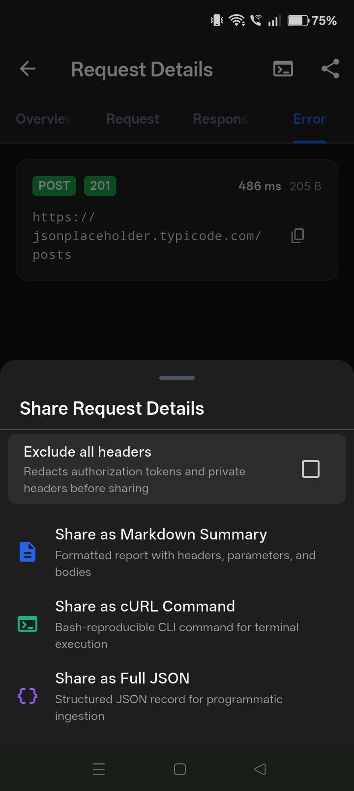

# fl_network_inspector

[](https://pub.dev/packages/fl_network_inspector)
[](https://opensource.org/licenses/MIT)

A lightweight, modular, and production-safe Flutter package that captures, persists, and displays all HTTP/HTTPS network requests and responses made by your application.

Deliver a comprehensive in-app debugging and traffic inspection experience similar to **Chucker** or **Charles Proxy**—entirely inside your host Flutter application with **zero external proxy setup**, **zero CA certificate installation**, and **zero UI layout side-effects**.

---

## Features

- 🚀 **Zero Proxy Setup**: Inspect traffic on mobile (iOS, Android), desktop (macOS, Windows, Linux), and web without installing certificates, changing WiFi proxies, or running reverse proxies on localhost.
- 📱 **Shake to Open**: Open the inspector at any time by shaking your physical device with hardware-level gravity isolation via `sensors_plus`.
- 🔋 **Battery-Conscious Lifecycle**: Accelerometer sensor listeners automatically pause when the app is backgrounded and resume when foregrounded.
- 💾 **Embedded SQLite Persistence**: High-speed, indexed SQLite storage via `sqflite` (mobile) and `sqflite_common_ffi` (desktop). Keeps your logs across app restarts, crashes, and reloads without memory leaks.
- ⚡ **Non-Blocking Write Queue**: Micro-task debounced batch queue ensures database I/O never drops a frame on your UI thread.
- 🔌 **Pluggable Client Adapters**:
  - Global `HttpOverrides` chaining for standard `dart:io` `HttpClient`.
  - Dedicated `NetworkInspectorDioInterceptor` for `Dio` 5.x apps.
  - Dedicated `NetworkInspectorHttpClient` subclassing `http.BaseClient` for `package:http`.
- 🔀 **Non-Destructive Stream Consumption**: Safely taps response byte streams without triggering `StateError: Stream has already been listened to`.
- 🛡️ **Sensitive Data Redaction**: Automatic redaction of sensitive credentials (`Authorization`, `Cookie`, `apiKey`, `password`, `token`, etc.) in request headers, query parameters, and JSON payloads.
- 📦 **Safe Payload Truncation**: Bounded buffers (default 1MB limit) prevent large file downloads/uploads from causing Out-Of-Memory (OOM) crashes.
- 📎 **Multipart Metadata Capture**: Captures form field names, file names, MIME types, and sizes while discarding raw binary bytes.
- 📋 **Terminal cURL Generation**: One-tap copy for bash-executable cURL commands with proper single-quote escaping (`'\''`) and line continuations.
- 📤 **Native Share Sheet Export**: Export transactions in Markdown, cURL, or JSON formats with iPadOS `RenderBox` anchor origin crash protection.
- 🎨 **Material 3 Inspector UI**: Filter by HTTP methods, status codes, errors-only, duration, and date ranges; debounced search; 4-tab inspection (Overview, Request, Response, Error); syntax-highlighted JSON viewer with isolate-based formatting for large payloads; and in-app Dark/Light theme switching.
- 🔒 **Production-Safe**: All interceptors, listeners, and database initializations compile to zero-overhead no-ops in release mode by default.

---

## Screenshots

| Request Listing | Filter Sheet | Request Overview |
| :---: | :---: | :---: |
|  |  |  |

| Request Body & Redaction | Response Headers & Body | Error Diagnostics | Share Export |
| :---: | :---: | :---: | :---: |
|  |  |  |  |

---

## Platform Support

| Platform | Traffic Capture | Storage Engine | Shake-to-Open | Native Share Sheet |
| :--- | :---: | :---: | :---: | :---: |
| **Android** (API 21+) | ✅ `HttpOverrides` / Dio / http | SQLite (`sqflite`) | ✅ Hardware (`sensors_plus`) | ✅ Native (`share_plus`) |
| **iOS** (12.0+) | ✅ `HttpOverrides` / Dio / http | SQLite (`sqflite`) | ✅ Hardware (`sensors_plus`) | ✅ Native (`share_plus`) |
| **macOS** (10.14+) | ✅ `HttpOverrides` / Dio / http | SQLite FFI (`sqflite_common_ffi`) | ⚠️ UI / Programmatic | ✅ Native (`share_plus`) |
| **Windows** | ✅ `HttpOverrides` / Dio / http | SQLite FFI (`sqflite_common_ffi`) | ⚠️ UI / Programmatic | ✅ Native (`share_plus`) |
| **Linux** | ✅ `HttpOverrides` / Dio / http | SQLite FFI (`sqflite_common_ffi`) | ⚠️ UI / Programmatic | ✅ Native (`share_plus`) |
| **Web** | ✅ Dio / `package:http` | In-Memory Buffer | ⚠️ UI / Programmatic | ✅ Web Share Sheet |

---

## Installation

Add `fl_network_inspector` to your `pubspec.yaml`:

```yaml
dependencies:
  flutter:
    sdk: flutter
  fl_network_inspector: ^1.0.1
```

Then run:

```bash
flutter pub get
```

---

## Quick Start

### 1. Initialize in `main()`

Initialize `NetworkInspector` before launching your application:

```dart
import 'package:flutter/material.dart';
import 'package:fl_network_inspector/fl_network_inspector.dart';

void main() async {
  WidgetsFlutterBinding.ensureInitialized();

  // Initialize the inspector
  await NetworkInspector.initialize(
    config: const NetworkInspectorConfig(
      enabled: true, // Defaults to kDebugMode
      enableShakeDetection: true, // Shake to open inspector
    ),
  );

  runApp(const MyApp());
}
```

### 2. Wrap your root widget with `NetworkInspectorWrapper`

Wrap your `MaterialApp` with `NetworkInspectorWrapper` and set `navigatorKey: NetworkInspector.navigatorKey`. This enables shake gesture detection and captures navigation context with zero UI layout interference:

```dart
class MyApp extends StatelessWidget {
  const MyApp({super.key});

  @override
  Widget build(BuildContext context) {
    return NetworkInspectorWrapper(
      child: MaterialApp(
        navigatorKey: NetworkInspector.navigatorKey, // Built-in key for contextless opening
        title: 'My Flutter App',
        home: const HomeScreen(),
      ),
    );
  }
}
```

*Alternative Builder syntax:*
```dart
MaterialApp(
  builder: NetworkInspectorWrapper.builder(),
  home: const HomeScreen(),
)
```

---

## Client Integration

### A. Global `dart:io` / `HttpOverrides` (Automatic)

When `enableAutoCapture: true` (the default) is configured in `NetworkInspectorConfig`, `NetworkInspector` automatically installs `HttpOverrides.global` with intelligent chaining, capturing all requests made via `HttpClient` (including those made by image loaders and standard packages) while preserving your existing app overrides.

### B. Dio Adapter (`NetworkInspectorDioInterceptor`)

For applications using `dio`:

```dart
import 'package:dio/dio.dart';
import 'package:fl_network_inspector/fl_network_inspector.dart';

final dio = Dio()
  ..interceptors.add(const NetworkInspectorDioInterceptor());
```

### C. package:http Adapter (`NetworkInspectorHttpClient`)

For applications using `package:http`:

```dart
import 'package:fl_network_inspector/fl_network_inspector.dart';
import 'package:http/http.dart' as http;

final client = NetworkInspectorHttpClient();

// Use client exactly as standard http.Client
final response = await client.get(Uri.parse('https://api.example.com/data'));
```

### D. Manual API Logging

For custom sockets, WebSockets, or GraphQL engines, log completed network calls or track two-phase requests manually:

```dart
// One-shot manual logging
await NetworkInspector.logApi(
  method: 'POST',
  url: 'https://api.example.com/graphql',
  statusCode: 200,
  requestHeaders: {'Content-Type': 'application/json'},
  requestBody: {'query': '{ users { id name } }'},
  responseBody: {'data': {'users': []}},
  duration: const Duration(milliseconds: 140),
);

// Two-phase request tracking
final tracker = NetworkInspector.startRequest(
  method: 'POST',
  url: 'https://api.example.com/checkout',
  body: {'orderId': 123},
);

try {
  // perform call ...
  await tracker.onResponse(statusCode: 200, body: {'status': 'PAID'});
} catch (e, stack) {
  await tracker.onError(error: e, stackTrace: stack);
}
```

---

## Programmatic Invocation

You can open the network inspector UI programmatically from a custom debug menu, developer drawer, or button action:

```dart
// Open with explicit BuildContext
NetworkInspector.open(context);

// Or open contextless (when registered with NetworkInspectorWrapper or navigatorKey)
NetworkInspector.open();
```

---

## Configuration Reference

`NetworkInspectorConfig` allows granular control over every aspect of capture, storage, and security:

| Parameter | Type | Default | Description |
|-----------|------|---------|-------------|
| `enabled` | `bool` | `!kReleaseMode` | Master kill-switch. When `false`, all interceptors, listeners, and repositories become instant no-ops. |
| `enableDatabase` | `bool` | `true` | Persist records to SQLite database. When `false`, uses in-memory repository. |
| `enableAutoCapture` | `bool` | `true` | Installs global `HttpOverrides` for automatic `dart:io` interception. |
| `enableShakeDetection` | `bool` | `true` | Enables accelerometer shake detection on supported platforms. |
| `shakeThreshold` | `double` | `15.0` | Dynamic vector acceleration threshold in m/s² (subtracts gravity). |
| `shakeDebounceMs` | `int` | `1500` | Cooldown period in milliseconds to suppress rapid duplicate shake triggers. |
| `maxRecords` | `int` | `500` | Maximum number of records retained in SQLite storage before FIFO pruning. |
| `maxBodyBytes` | `int` | `1048576` (1MB) | Maximum payload byte length buffered per request/response body before truncation. |
| `customRedactionKeys` | `List<String>` | `[]` | Additional sensitive keys to redact from headers, query parameters, and JSON payloads. |
| `includeMultipartFilePaths` | `bool` | `false` | Retain local file paths in captured multipart form inspection metadata. |
| `ignoredHosts` | `List<String>` | `[]` | Hostnames completely bypassed from interception (e.g. analytics or crash reporters). |
| `ignoredUrls` | `List<String>` | `[]` | Substring URLs bypassed from interception. |
| `navigatorKey` | `GlobalKey<NavigatorState>?` | `null` | Root navigator key for contextless programmatic opening. |

---

## API Tracing & Duplicate Request Optimization

Every network call made by your application is recorded as an independent transaction with a unique UUID, high-resolution timestamp, and exact execution duration.

- **Duplicate Calls Detection:** If your application accidentally issues multiple identical requests (e.g., redundant background fetches or un-debounced button taps), each request is preserved in SQLite so you can pinpoint redundant network bandwidth and implement caching.
- **Cross-Interceptor Safety:** While repeated app calls are always recorded, the inspector uses synthetic deduplication headers to prevent the *same* physical request from being double-counted if both `HttpOverrides` and `NetworkInspectorDioInterceptor` are active.

---

## Android 15 & 16 Ready (Edge-to-Edge & 16KB Page Size)

- **Edge-to-Edge Windows:** Fully respects transparent system navigation bars and status bars with dynamic safe-area insets (`MediaQuery.viewPaddingOf(context)`).
- **16KB Page Size Compatible:** Aligned for Android 15 & 16 devices requiring 16 KB page-size shared library alignment (`useLegacyPackaging = false`).

---

## Production Safety

By default, `NetworkInspectorConfig.enabled` defaults to `kDebugMode`:
- In **Release Builds (`kReleaseMode`)**, all interceptors immediately forward requests and responses without capturing or reading bodies.
- SQLite databases are not opened or initialized.
- Hardware accelerometer sensors are completely unhooked.
- Zero memory or performance overhead in production.

If you wish to test the inspector in internal staging or release profile builds, pass `enabled: true` explicitly:

```dart
await NetworkInspector.initialize(
  config: const NetworkInspectorConfig(enabled: true),
);
```

---

## Example App

Check out the [`example/`](example) folder for a complete Flutter application demonstrating:
- Interception of GET, POST, and multipart requests
- Handling 404 and 500 error responses
- Socket and network failures
- Manual GraphQL logging
- Shake-to-open gesture in action

To run the example app:

```bash
cd example
flutter run
```

---

## License

This project is licensed under the MIT License - see the [LICENSE](LICENSE) file for details.
